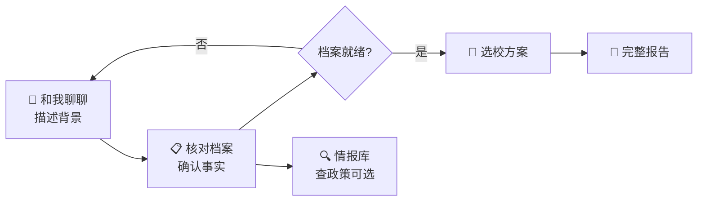

# 香港留学规划智能体 · hk-study-agent

> **对话建档 → 核对画像 → 选校方案 → 交付报告 → 情报库检索**  
> 面向香港授课型硕士申请的 AI 顾问工作台，把零散背景整理成可执行的申请路径。

<p align="center">

[](https://nodejs.org/)
[](https://vitejs.dev/)
[](https://fastify.dev/)
[](https://github.com/zhaoyixuanyxz/hk-study-agent)

</p>

---

## 你能用它做什么？

| 需求 | 系统帮你 |
|------|----------|
| 不想填超长表单，想自然语言说清楚背景 | **对话建档**，顾问式追问 |
| 关键信息是否齐全、能否出方案 | **画像** 缺口提示 + 确认事实 |
| 要冲刺 / 匹配 / 保底梯度建议 | **选校方案** + 风险提示 + 图表 |
| 需要可留存、可分享的完整报告 | **报告** 在线阅读、PDF、分享链接 |
| 查港校政策、截止、学费等官方情报 | **情报库** 检索 + 来源引用 |
| 运营侧审核采集条目、安全爬取 | **运营审核**（审核员账号） |

> 💡 **一句话**：Chat 负责「收集」；Profile / Plan / Report 负责「交付」；Intelligence 负责「有据可查」。

---

## 5 分钟上手（Windows）

### ① 准备两样东西

- **Node.js 20+**（[nodejs.org](https://nodejs.org/)）
- **DeepSeek API Key**（[platform.deepseek.com](https://platform.deepseek.com) 申请；**留空则用 Mock LLM**，本地可跑通、不耗额度）

### ② 配置密钥（只需做一次）

```powershell
# 在 hk-study-agent 根目录
copy .env.example .env
# 用记事本打开 .env，可选填入：
# DEEPSEEK_API_KEY=你的密钥
# INTELLIGENCE_REVIEWER_EMAILS=你的邮箱   # 运营审核 Tab
```

> ⚠️ **切勿**把 `.env` 提交到 Git；仓库已忽略密钥与 `backend/data/db.json`。

### ③ 一键启动

**双击** `启动项.bat`，或在 PowerShell 中：

```powershell
.\启动项.bat
```

浏览器会自动打开 **http://127.0.0.1:5180**  
API 健康检查：**http://127.0.0.1:8010/health**（应返回 `{"status":"ok"}`）

> ⚠️ 首次启动会安装依赖、同步情报 feed，可能需要几分钟。  
> 关掉了？重新双击 `启动项.bat`；结束服务用 `关闭项.bat`。

---

## 给他人使用 · 方案 A（推荐试点）

**你托管，同事只开浏览器** — 不用装 Node、不用自己申请 API Key。

| 你是谁 | 做什么 |
|--------|--------|
| **管理员（你）** | 本机 `启动项.bat` 起前后端 → 用 **Tailscale** 把内网地址发给同事 |
| **使用者** | 打开链接 → 注册/登录 → 按 6 Tab 流程建档 |

```text
快速试点（对方零安装）：
  1. 本机 .env 填好 DEEPSEEK_API_KEY（可选）
  2. 双击 启动项.bat
  3. Tailscale 分享 http://<你的虚拟IP>:5180  （API 同机 8010，由 Vite 代理）
```

后端 `CORS_ORIGINS` 需包含同事实际打开的页面来源（本机或 Tailscale 地址）。

### 24 小时在线 · 你关机也能用（方案 B，推荐长期）

**Docker + 便宜云主机（约 ¥50/月）**，同事只打开公网地址。

📖 一步步操作 → **[docs/v1.verson/V1-云试点部署Runbook.md](docs/v1.verson/V1-云试点部署Runbook.md)**

```bash
# 在 Ubuntu 云服务器上
git clone https://github.com/zhaoyixuanyxz/hk-study-agent.git && cd hk-study-agent
cp .env.production.example .env.production   # 填入 DEEPSEEK_API_KEY、CORS_ORIGINS
docker compose -f docker-compose.prod.yml up -d --build
```

### GitHub Pages（仅静态前端 · 可选）

推送 `main` 后 Actions 自动发布 UI：**https://zhaoyixuanyxz.github.io/hk-study-agent/**  
API 仍需另部署；仓库 Variable 配置 `VITE_API_BASE`，后端 `CORS_ORIGINS` 加入 Pages 地址。

📖 完整步骤 → **[docs/GitHub-Pages静态托管.md](docs/GitHub-Pages静态托管.md)**

---

## 界面长什么样？六个 Tab 够用

```
┌─────────────┬─────────────┬─────────────┬─────────────┬─────────────┬─────────────┐
│ 💬 和我聊聊  │ 📋 核对档案  │ 🎯 选校方案  │ 📄 完整报告  │ 🕐 过往记录  │ 🔍 情报库   │
│ 对话建档    │ 画像确认    │ 三档建议    │ PDF/分享    │ 会话回溯    │ 院校检索    │
└─────────────┴─────────────┴─────────────┴─────────────┴─────────────┴─────────────┘
        （审核员另可见：运营审核 · 链接探活 · 安全采集）
```

| Tab | 你可以把它理解成… | 日常要不要进 |
|-----|-------------------|--------------|
| **和我聊聊** | 顾问对话：收集背景、待确认事实 | ✅ 必用 |
| **核对档案** | 汇总画像、缺口、能否生成方案 | ✅ 必用 |
| **选校方案** | 冲刺/匹配/保底 + 引用与图表 | 出方案时 |
| **完整报告** | 可交付长文 + 行动计划勾选 | 要报告时 |
| **过往记录** | 会话、快照、历史方案/报告 | 回溯时 |
| **情报库** | 港校政策检索（带来源链接） | 查政策时 |

---

## 推荐流程（第一次用，照做就行）



### 场景 A · 从零到一份方案

```
和我聊聊 → 核对档案（补缺口、点确认）→ 选校方案 → 需要时再生成完整报告
```

### 场景 B · 只查院校政策

```
情报库 → 选院校或关键词搜索 → 卡片点来源链接核对官网
```

> 📌 **关键一点**：`DEEPSEEK_API_KEY` 留空时对话为 Mock，适合联调；正式顾问质量请配置真实 Key。

---

## 支持哪些能力？

| 能力 | 说明 |
|------|------|
| 对话建档 | 多轮追问 + 待确认事实条 |
| 画像快照 | `planInputView`、就绪度、分区档案 |
| 选校方案 | 三档梯度、≥6 条引用、Chart.js 可视化 |
| 交付报告 | Markdown 正文、风险面板、30/60/90 行动计划 |
| 报告 PDF | Puppeteer（CI 可设 `PDF_DISABLED=1` 跳过） |
| 分享链接 | `GET /api/v1/public/reports/:token` |
| 情报库 | 港八大种子 + 可选真爬（`INTELLIGENCE_FETCH=1`） |

---

## 遇到问题？先看这张表

| 你看到的 | 多半是因为… | 怎么办 |
|----------|------------|--------|
| 登录后接口 401 / CORS 报错 | 后端未起或 `CORS_ORIGINS` 未含前端地址 | 确认 `8010` 健康检查；改 `.env` 后重启 backend |
| 对话像「假回复」 | `DEEPSEEK_API_KEY` 为空 | Mock 模式正常；要真模型则填 Key |
| 方案/报告引用很少 | 情报未同步或未爬取 | `cd backend && npm run intelligence:sync-feeds` |
| Pages 顶部黄条「未连接 API」 | 静态站未配 `VITE_API_BASE` | 见 [GitHub-Pages静态托管.md](docs/GitHub-Pages静态托管.md) |
| 双击 bat 闪退 | 文件带 UTF-8 BOM | 存为 UTF-8 无 BOM；或用 `启动项-保持窗口.bat` |
| PDF 下载失败 | 未装 Chromium / `PDF_DISABLED=1` | 本地 `cd backend && npm install`；生产见 Runbook |

版本回退见 **[Git回退指南.md](Git回退指南.md)**（标签 `baseline-2026-05-11`、`m-v3-2026-05-30`）。

---

## 项目结构（给开发者）

```
hk-study-agent/
├── 启动项.bat / 关闭项.bat     ← 一键启动（日常用这个就够）
├── backend/                    ← Fastify API + Agent + 情报管线
├── frontend/                   ← Vite 6 Tab 工作台
├── docs/                       ← 产品文档、V1/V3 路线图、QA 归档
├── deploy/                     ← Docker / Nginx（方案 B）
└── .github/workflows/          ← GitHub Pages 自动部署
```

**本地数据不上传 Git**：`.env`、`backend/data/db.json`、`.cursor/`、运行时状态文件。

---

## 测试（给开发者）

```bash
cd backend && npm test
# V3 总门禁（推荐发布前）
npm run test:v1-v3 && npm run test:v1-p6
cd ../frontend && npm test && npm run build
```

---

## 更多文档

| 文档 | 适合谁 |
|------|--------|
| [docs/v1.verson/README.md](docs/v1.verson/README.md) | 产品 / 研发 · V1 文档入口 |
| [docs/v1.verson/V1-迭代路线图V3-详细任务清单.md](docs/v1.verson/V1-迭代路线图V3-详细任务清单.md) | 研发 · V3 任务与验收 |
| [docs/v1.verson/V1-V3-Sprint-QA-归档-2026-05-30.md](docs/v1.verson/V1-V3-Sprint-QA-归档-2026-05-30.md) | QA · 手测清单 |
| [docs/GitHub-Pages静态托管.md](docs/GitHub-Pages静态托管.md) | 管理员 · Pages 静态站 |
| [docs/v1.verson/V1-云试点部署Runbook.md](docs/v1.verson/V1-云试点部署Runbook.md) | 管理员 · Docker 云试点 |
| [docs/Phase2-交付物与验收说明.md](docs/Phase2-交付物与验收说明.md) | 验收 · Phase2 API |
| [Git回退指南.md](Git回退指南.md) | 开发 · 标签回退 |

---

<p align="center">

**聊清楚背景，画像有据可查，方案梯度分明，报告留得住、找得到。**

<sub>M-V3 · 情报探活 / Chat 边界 / ≥6 引用 / 方案报告可视化</sub>

</p>
