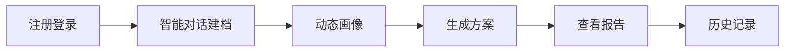

# 留学规划智能体 MVP 产品文档

**版本**：v1.0  
**基于文档**：`PRD-留学规划智能体.md`  
**适用阶段**：MVP 首发版  
**目标**：在最小范围内验证用户是否愿意通过智能对话完成建档，并接受系统生成的动态画像、方案与报告。

---

## 1. MVP 定义

MVP 的核心不是做完整留学平台，而是先跑通一个最小可用闭环：

1. 用户注册并登录
2. 与建档 Agent 进行开放式对话
3. 生成动态用户画像
4. 获得 1 套留学申请方案
5. 生成 1 份可查看的分析报告
6. 平台完成基础存储，支持用户回看历史结果

MVP 重点验证三件事：

- 用户是否愿意通过长对话方式持续提供较完整的留学背景信息
- 平台生成的方案是否足够有用、可理解、可接受
- 用户是否愿意保存、查看、下载或分享报告结果

---

## 2. 目标用户

### 2.1 核心用户

- 计划申请海外本科或研究生项目的学生
- 希望快速获得留学定位与申请建议的学生家长

### 2.2 典型特征

- 对申请流程了解有限，难以判断自身定位
- 缺少系统性的选校、预算和时间规划
- 愿意通过自然语言互动换取结构化建议与个性化洞察

---

## 3. MVP 要解决的问题

MVP 只聚焦解决以下三个核心问题：

1. 用户不知道自己当前条件适合申请什么层级、什么国家/地区
2. 用户无法快速形成一套完整的申请初步方案
3. 用户缺少一份可保存的留学规划报告，难以后续执行或与家长沟通

---

## 4. MVP 目标与成功标准

### 4.1 产品目标

- 让用户在一次使用中完成从建档到方案输出的完整体验
- 在 2 分钟内生成可阅读报告，形成可感知价值
- 用最少功能验证产品核心价值，而不是追求平台完整性

### 4.2 MVP 成功指标

| 指标 | MVP 目标 |
|------|----------|
| 建档对话完成率 | >= 60% |
| 方案生成成功率 | >= 95% |
| 报告生成成功率 | >= 95% |
| 报告平均生成时长 | < 2 分钟 |
| 首次使用后满意度 | >= 4/5 |

---

## 5. MVP 范围

### 5.1 In Scope

#### A. 账号能力

- 用户注册
- 用户登录/退出
- 基础账号数据隔离

#### B. 智能对话建档 Agent

- 以自然语言对话替代固定问卷
- 支持开放式、长对话、任意顺序表达
- Agent 在必要时主动追问关键信息
- 将原问卷维度封装为 Prompt 策略层，而不是前端字段流程
- 对话覆盖学术背景、语言与标化、研究/实习/工作经历、目标国家/地区、专业方向、学位类型、预算、入学时间与准备周期

#### C. 用户画像

- 基于多轮对话生成动态用户画像
- 画像包含结构化数据、非结构化记忆、实体记忆和向量嵌入
- 允许自动发现并吸收新维度
- 用户可查看画像摘要、关键洞察与待补充项

#### D. 方案生成

- 基于画像生成 1 套留学申请方案
- 方案需包含：
  - 冲刺/匹配/保底梯度
  - 录取概率或竞争力区间
  - 时间规划建议
  - 预算建议
  - 风险提示与备选建议

#### E. 报告输出

- 生成 1 份完整分析报告
- 报告优先采用 **HTML 在线查看** 形式
- 支持基础存储与回看

#### F. 基础存储

- 保存对话线程与摘要
- 保存长期记忆与实体记忆
- 保存画像结果
- 保存方案结果
- 保存报告记录

### 5.2 Out of Scope

以下能力明确不纳入 MVP：

- 院校库搜索与筛选
- 多方案生成（如 5 套）
- 方案对比器
- 进度提醒
- 数据更新系统的完整自动化 pipeline
- PDF 下载
- 复杂图表体系
- 家长协同账号
- 真人顾问协同后台
- 自动代填网申、自动投递申请
- 完整的多 Agent 编排运营后台
- 用户可手动编辑底层记忆图谱的高级能力

---

## 6. MVP 核心用户路径

### 路径说明

1. 用户完成注册登录
2. 用户与建档 Agent 开展自然语言对话
3. 系统在对话中逐步生成动态用户画像
4. 系统生成 1 套申请方案
5. 系统生成报告并展示
6. 用户可在历史记录中再次查看

---

## 7. MVP 功能需求

## 7.1 账号模块

### 需求

- 支持邮箱或手机号注册登录
- 登录后只能查看自己的对话、画像、方案和报告

### 验收标准

- 新用户可完成注册并成功登录
- 登录态失效后需重新登录
- 用户 A 无法访问用户 B 的记录

---

## 7.2 智能对话建档模块

### 需求

- 以对话形式代替固定问卷
- 支持任意顺序、开放式自然语言输入
- Agent 可根据上下文主动追问
- 支持会话中断后恢复
- 通过系统 Prompt 封装原有建档维度与采集目标

### 核心采集主题

- 当前学历、院校、专业
- GPA 或成绩体系
- 语言成绩
- 标化成绩
- 科研/实习/工作经历
- 目标国家/地区
- 目标专业和学位
- 预算区间
- 入学时间

### 验收标准

- 用户无需按固定表单顺序即可完成建档
- 当关键信息不足时，Agent 会主动追问或标记缺失
- 会话中断后再次进入可续接上下文
- 对话达到最小信息门槛后能生成对应画像

---

## 7.3 用户画像模块

### 需求

- 根据对话内容自动构建动态画像
- 画像应至少覆盖学术、语言、经历、偏好、时间规划五类信息
- 支持结构化摘要、非结构化长期记忆、实体记忆和向量索引
- 支持自动发现新维度并纳入画像

### 验收标准

- 画像内容与对话事实一致
- 用户打开画像页时可正常查看完整摘要
- 若数据缺失，页面要给出明确提示
- 用户再次进入系统时，Agent 能基于历史记忆延续对话

---

## 7.4 方案生成模块

### 需求

- 基于画像生成 1 套申请方案
- 方案需覆盖至少 3 档申请策略：冲刺、匹配、保底
- 输出竞争力判断及简要原因
- 输出预算建议与时间线建议

### 验收标准

- 每次生成结果都包含冲刺、匹配、保底三个层级
- 每个层级至少有对应院校/项目建议或策略说明
- 页面明确展示免责声明：结果仅为参考建议，不构成录取承诺
- 生成失败时需给出明确错误提示和重试入口

---

## 7.5 报告模块

### 需求

- 基于画像和方案生成完整报告
- 报告最少包含以下章节：
  1. 用户画像总结
  2. 目标院校/方向分析
  3. 时间规划表
  4. 材料清单
  5. 标化考试规划
  6. 预算分析
  7. 风险与对策
- 正文总字数不少于 1000 字
- 报告支持在线查看

### 验收标准

- 报告七章齐全
- 报告正文 >= 1000 字
- 报告生成时间平均 < 2 分钟
- 用户退出后重新登录仍可查看历史报告

---

## 8. MVP 页面范围

MVP 只保留 5 个核心页面：

1. 登录/注册页
2. 智能对话建档页
3. 用户画像页
4. 方案结果页
5. 报告详情页

不做独立院校库、方案对比器、提醒中心、复杂仪表盘。

---

## 9. MVP 风险与约束

### 9.1 风险

- 对话过长导致流失
- 高温度 Agent 归纳错误或事实漂移
- 方案解释不足导致用户不信任结果
- 报告生成过慢影响体验

### 9.2 应对策略

- 用 Prompt 策略约束 Agent 的采集主题和追问边界
- 在关键事实节点执行摘要确认，降低高温度漂移
- 方案结果展示核心原因说明，而不是只给结论
- 报告采用异步生成和结果落库，避免页面阻塞

---

## 10. MVP 核心任务拆解

以下拆解按交付顺序组织，适合直接转为产品、设计、研发排期。

### T1. 确认 MVP 范围冻结

**目标**：把完整 PRD 收敛成首发闭环。  
**输出**：

- MVP 功能清单
- MVP 不做清单
- 首发验收口径

### T2. 设计智能对话建档框架

**目标**：定义对话 Agent 如何完成建档与信息补全。  
**输出**：

- 系统 Prompt 框架
- 核心采集主题列表
- 追问策略与缺口识别规则
- 会话中断恢复规则
- 最小可生成画像的信息门槛

### T3. 设计动态用户画像结构

**目标**：把原始对话内容转成可读、可检索、可延续的画像。  
**输出**：

- 画像页面结构
- 结构化摘要字段
- 非结构化记忆设计
- 实体记忆与向量嵌入策略
- 缺失字段提示策略

### T4. 设计方案生成规则

**目标**：定义 MVP 如何输出一套有解释性的方案。  
**输出**：

- 输入参数清单
- 冲刺/匹配/保底规则
- 竞争力区间说明模板
- 风险提示模板

### T5. 设计报告模板

**目标**：确保方案结果可沉淀为完整文档。  
**输出**：

- 报告七章模板
- 章节数据映射关系
- HTML 展示模板
- 字数校验规则

### T6. 账号与数据存储实现

**目标**：打通最基础的数据闭环。  
**输出**：

- 账号表与登录能力
- 对话线程、消息、摘要、记忆、画像、方案、报告的数据表
- 历史记录查询接口
- 基础权限控制

### T7. 前端核心页面实现

**目标**：完成 MVP 五个页面。  
**输出**：

- 登录/注册页
- 智能对话页
- 画像页
- 方案页
- 报告页

### T8. 方案生成与报告生成接口实现

**目标**：完成核心智能能力接入。  
**输出**：

- 对话建档 Agent 接口
- 画像生成接口
- 方案生成接口
- 报告生成接口
- 异常处理与重试机制

### T9. 埋点与验证机制

**目标**：支持 MVP 上线后验证效果。  
**输出**：

- 对话开始/中断/完成埋点
- 关键追问命中率埋点
- 方案生成成功/失败埋点
- 报告查看/留存埋点
- 满意度收集入口

### T10. QA 与上线验收

**目标**：确保 MVP 可上线试运行。  
**输出**：

- 核心链路测试用例
- 验收清单
- 回归测试结果
- 上线检查项

---

## 11. 建议的执行优先级

### 第一优先级

- T1 范围冻结
- T2 智能对话建档框架
- T4 方案生成规则
- T6 数据存储与权限
- T7 核心页面
- T8 生成接口

### 第二优先级

- T3 画像结构优化
- T5 报告模板完善
- T9 埋点与满意度机制

### 第三优先级

- T10 QA 与上线验收

---

## 12. 建议的里程碑

| 里程碑 | 目标 |
|--------|------|
| M1 | 完成范围冻结、对话建档框架、画像结构、方案规则 |
| M2 | 完成后端数据模型、生成接口、前端核心页面 |
| M3 | 完成报告页、历史记录、埋点、验收测试 |

---

## 13. 一句话总结

MVP 版留学规划智能体的核心，是先验证“用户是否愿意通过自然语言与 Agent 完成建档，并为一套自动生成的留学方案与报告买单或持续使用”，因此所有首发能力都必须围绕这个对话闭环服务，而不是提前做完整平台能力。
