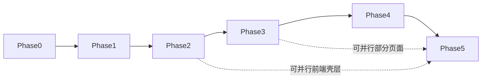

# 留学规划智能体 MVP 完整任务拆分清单

**版本**：v1.4  
**颗粒度**：Epic / 模块级（可直接导入项目管理工具）  
**组织方式**：先按阶段（Phase 0–5），每阶段下按角色（产品 / AI / 后端 / 前端 / QA）拆分  

**依据文档**：
- [MVP-开发路线确认稿.md](MVP-开发路线确认稿.md)
- [MVP-产品文档-留学规划智能体.md](MVP-产品文档-留学规划智能体.md)
- [智能对话建档系统架构设计.md](智能对话建档系统架构设计.md)
- [对话建档Prompt设计稿.md](对话建档Prompt设计稿.md)

---

## 项目进度总览

**当前执行阶段**：—（MVP Phase 0–5 均已收口；里程碑 M4 见下表「里程碑与阶段验收对照」）

**上一完成阶段**：Phase 5 — ✅ 已关闭（交付/验收 [Phase5-交付物与验收说明.md](Phase5-交付物与验收说明.md)；任务索引 [Phase5-可落地任务细化清单.md](Phase5-可落地任务细化清单.md)；埋点 [Phase5-埋点需求与事件字典.md](Phase5-埋点需求与事件字典.md)；上线检查 [Phase5-上线检查清单.md](Phase5-上线检查清单.md)；发布与模型 [Phase5-发布与模型版本说明.md](Phase5-发布与模型版本说明.md)；QA [Phase5-QA-全链路与上线用例.md](Phase5-QA-全链路与上线用例.md)；观测与鉴权端点见 [Phase1-API-联调说明.md](Phase1-API-联调说明.md)）

**更早阶段**：Phase 0–4 — ✅ 已完成／关闭（Phase 0 见 [Phase0-交付物索引.md](Phase0-交付物索引.md)；Phase 1 见 [Phase1-API-联调说明.md](Phase1-API-联调说明.md)；Phase 2 见 [Phase2-交付物与验收说明.md](Phase2-交付物与验收说明.md)；Phase 3 见 [Phase3-交付物与验收说明.md](Phase3-交付物与验收说明.md)、[Phase3-方案生成能力任务清单.md](Phase3-方案生成能力任务清单.md)；Phase 4 见 [Phase4-交付物与验收说明.md](Phase4-交付物与验收说明.md)、[Phase4-报告与历史任务细化清单.md](Phase4-报告与历史任务细化清单.md)、[Phase4-QA-报告与历史用例.md](Phase4-QA-报告与历史用例.md)、[Phase4-openapi.yaml](Phase4-openapi.yaml)）

**维护方式**：阶段验收通过后，将下表中对应 Phase 的「状态」更新为 ✅ 已完成，并同步更新「当前执行阶段」一行。

| Phase | 阶段名称 | 状态 | 说明 |
|-------|----------|------|------|
| 0 | 范围冻结与技术方案定稿 | ✅ 已完成 | 范围/契约/验收基线已定稿 |
| 1 | 对话建档核心引擎 | ✅ 已完成 | 后端+前端+测试；见 [Phase1-API-联调说明.md](Phase1-API-联调说明.md) |
| 2 | 动态画像与记忆系统 | ✅ 已完成 | 见 [Phase2-交付物与验收说明.md](Phase2-交付物与验收说明.md) |
| 3 | 方案生成能力 | ✅ 已顺利完成 | 交付/验收 [Phase3-交付物与验收说明.md](Phase3-交付物与验收说明.md)；任务索引 [Phase3-方案生成能力任务清单.md](Phase3-方案生成能力任务清单.md)；契约 [Phase3-openapi.yaml](Phase3-openapi.yaml) |
| 4 | 报告生成与历史记录 | ✅ 已关闭 | 交付/验收 [Phase4-交付物与验收说明.md](Phase4-交付物与验收说明.md)；任务索引 [Phase4-报告与历史任务细化清单.md](Phase4-报告与历史任务细化清单.md)；QA [Phase4-QA-报告与历史用例.md](Phase4-QA-报告与历史用例.md)；契约 [Phase4-openapi.yaml](Phase4-openapi.yaml) |
| 5 | 前端闭环与上线准备 | ✅ 已关闭 | 交付/验收 [Phase5-交付物与验收说明.md](Phase5-交付物与验收说明.md)；任务索引 [Phase5-可落地任务细化清单.md](Phase5-可落地任务细化清单.md)；埋点 [Phase5-埋点需求与事件字典.md](Phase5-埋点需求与事件字典.md)；上线检查 [Phase5-上线检查清单.md](Phase5-上线检查清单.md)；发布与模型 [Phase5-发布与模型版本说明.md](Phase5-发布与模型版本说明.md)；QA [Phase5-QA-全链路与上线用例.md](Phase5-QA-全链路与上线用例.md)；观测与限流见 [Phase1-API-联调说明.md](Phase1-API-联调说明.md) |

---

## 文档说明

### 字段约定

每条 Epic 尽量包含：

| 字段 | 说明 |
|------|------|
| **目标** | 该 Epic 要达成的能力或决策结果 |
| **依赖** | 必须先完成的前置 Epic 或阶段 |
| **交付物** | 可验收的产出物 |
| **验收标准** | 如何判断完成 |
| **并行** | 是否可与同阶段其他 Epic 并行 |

### 范围约束

- 仅包含 MVP 范围内能力，不包含院校库、多方案、提醒、PDF、顾问后台、多 Agent 编排平台等非 MVP 项。
- 不展开到接口字段级、表字段级设计。

---

## 范围与不做项（与 MVP 对齐）

### 本期必须交付

账号、智能对话建档、会话恢复、动态画像、单套方案、HTML 报告、历史与基础存储、基础埋点与上线验收。

### 本期明确不做

院校库搜索筛选、多方案与对比、进度提醒、PDF、复杂图表、家长协同、真人顾问、自动投递、完整多 Agent 运营后台、用户手动编辑底层记忆图谱。

---

## 总体阶段视图

**推荐顺序**：Phase 0 → 1 → 2 → 3 → 4 → 5；前端可在 Phase 2 之后并行，但不得早于核心接口与数据契约定稿。

---

## Phase 0：范围冻结与技术方案定稿

**阶段状态**：✅ 已完成  

**阶段目标**：产品定义转为研发可执行边界，冻结画像快照与方案输入视图（`planInputView`）概念，避免开发期反复改向。

**阶段依赖**：无。

**Phase 0 交付物汇总**：[Phase0-交付物索引.md](Phase0-交付物索引.md)

### 产品

| Epic ID | 名称 | 目标 | 依赖 | 交付物 | 验收标准 | 并行 |
|---------|------|------|------|--------|----------|------|
| P0-PM-01 | MVP 范围冻结与变更规则 | 锁定 In/Out scope 与变更流程 | 无 | 范围基线说明、变更记录模板 | 产品/研发对范围签字或共识记录 | 是 |
| P0-PM-02 | 验收口径与成功指标落地 | 将建档对话完成率、方案/报告成功率等写成可测定义 | P0-PM-01 | 验收清单草案、指标口径表 | 每条指标有数据来源与统计方式 | 是 |

### AI / 算法

| Epic ID | 名称 | 目标 | 依赖 | 交付物 | 验收标准 | 并行 |
|---------|------|------|------|--------|----------|------|
| P0-AI-01 | 对话建档技术路线确认 | 确认单 Agent、高温度主对话 + 低温度事实链路的可行性 | P0-PM-01 | 技术路线说明、模型与温度策略 | 与架构文档一致，无多 Agent 平台依赖 | 是 |
| P0-AI-02 | planInputView 与画像快照契约 | 定义下游方案可消费的稳定输入结构（概念层） | P0-PM-01 | 字段清单与必选/可选说明 | 方案团队可据此设计生成逻辑 | 否，建议先于大规模开发 |

### 后端

| Epic ID | 名称 | 目标 | 依赖 | 交付物 | 验收标准 | 并行 |
|---------|------|------|------|--------|----------|------|
| P0-BE-01 | 服务边界与模块划分 | 划分对话、画像、方案、报告服务边界 | P0-AI-02 | 模块边界图或说明 | 无职责重叠或遗漏主路径 | 是 |
| P0-BE-02 | 账号与鉴权基线 | 确定注册登录方式与安全基线 | P0-PM-01 | 鉴权方案说明 | 与 MVP 账号需求一致 | 是 |

### 前端

| Epic ID | 名称 | 目标 | 依赖 | 交付物 | 验收标准 | 并行 |
|---------|------|------|------|--------|----------|------|
| P0-FE-01 | 五页信息架构与路由草案 | 登录、对话、画像、方案、报告页结构与导航 | P0-PM-01 | IA/路由草图 | 与 MVP 页面范围一致 | 是 |

### QA

| Epic ID | 名称 | 目标 | 依赖 | 交付物 | 验收标准 | 并行 |
|---------|------|------|------|--------|----------|------|
| P0-QA-01 | 测试策略与主链路用例框架 | 定义 Phase 1–5 主链路测试框架 | P0-PM-02 | 测试范围说明 | 覆盖注册→对话→画像→方案→报告 | 是 |

**阶段验收**：范围冻结；`planInputView`/画像快照概念达成一致；不再以固定问卷为首发路径。

---

## Phase 1：对话建档核心引擎

**阶段状态**：✅ 已完成（实现与联调见 [Phase1-API-联调说明.md](Phase1-API-联调说明.md)；细分任务见 [Phase1-对话建档核心引擎任务清单.md](Phase1-对话建档核心引擎任务清单.md)）

**阶段目标**：系统具备多轮自然语言建档能力：会话管理、Prompt 策略、建档 Agent、中断恢复。

**阶段依赖**：Phase 0 完成。

**架构映射**：`ConversationUI`（接口契约）、`DialogueOrchestrator`、`PromptStrategyLayer`、`ProfileAgent`（对话侧）。

### 产品

| Epic ID | 名称 | 目标 | 依赖 | 交付物 | 验收标准 | 并行 |
|---------|------|------|------|--------|----------|------|
| P1-PM-01 | 对话状态与用户体验原则 | 定义追问节奏、单轮问题数量上限等 | Phase 0 | UX 原则说明 | 与 Prompt 设计稿不冲突 | 是 |

### AI / 算法

| Epic ID | 名称 | 目标 | 依赖 | 交付物 | 验收标准 | 并行 |
|---------|------|------|------|--------|----------|------|
| P1-AI-01 | Prompt 策略层落地 | 实现 system / style / collection / confirmation / readiness 等分层策略可配置 | Phase 0 | Prompt 配置与版本管理方案 | 可独立调参、可回滚 | 是 |
| P1-AI-02 | 建档 Agent 核心逻辑 | 高温度主对话：理解、追问、缺口输出 | P1-AI-01 | Agent 服务或链 | 连续 3–5 轮对话连贯、可追问 | 否，依赖 Prompt |
| P1-AI-03 | 对话编排状态机 | Init / Explore / GapProbing / FactConfirmation / ProfileReady 等状态转换规则 | P1-AI-02 | 状态机说明 + 实现接口 | 与架构文档状态机一致 | 否 |

### 后端

| Epic ID | 名称 | 目标 | 依赖 | 交付物 | 验收标准 | 并行 |
|---------|------|------|------|--------|----------|------|
| P1-BE-01 | 对话线程与消息存储 | 创建会话、持久化消息、分页查询 | Phase 0 | 线程与消息 API | 消息不丢、按用户隔离 | 是 |
| P1-BE-02 | 对话编排与 Agent 调用编排服务 | 接收用户输入、组装上下文、调用 Agent、返回回复 | P1-BE-01, P1-AI-02 | 编排服务 API | 端到端可调通 | 否 |
| P1-BE-03 | 会话中断恢复 | 再次进入可加载历史消息与状态 | P1-BE-01 | 恢复接口与逻辑 | 关闭页面后重进可续聊 | 否 |

### 前端

| Epic ID | 名称 | 目标 | 依赖 | 交付物 | 验收标准 | 并行 |
|---------|------|------|------|--------|----------|------|
| P1-FE-01 | 对话页 MVP（可先 API 联调版） | 发消息、展示历史、加载状态 | P1-BE-02 | 对话页组件 | 可完成多轮发送与展示 | 是 |

### QA

| Epic ID | 名称 | 目标 | 依赖 | 交付物 | 验收标准 | 并行 |
|---------|------|------|------|--------|----------|------|
| P1-QA-01 | 对话主链路用例 | 多轮、中断恢复、异常网络 | Phase 1 功能可用 | 用例集 | 主路径可自动化或手工执行 | 是 |

**阶段验收**：用户可发起建档对话；多轮互动；会话可恢复。

---

## Phase 2：动态画像与记忆系统

**阶段状态**：✅ 已完成（交付物、验收与接口契约见 [Phase2-交付物与验收说明.md](Phase2-交付物与验收说明.md)）

**阶段目标**：对话沉淀为动态画像；摘要、实体、长期语义记忆；事实确认；画像快照供下游使用。

**阶段依赖**：Phase 1。

**架构映射**：`MemorySystem`、`DynamicProfileEngine`、`FactValidationLayer`、画像快照 → `planInputView` 准备。

### 产品

| Epic ID | 名称 | 目标 | 依赖 | 交付物 | 验收标准 | 并行 |
|---------|------|------|------|--------|----------|------|
| P2-PM-01 | 画像页信息架构 | 摘要、洞察、待补充、更新时间展示规则 | Phase 0 | 画像页线框或说明 | 与 MVP 画像模块验收一致 | 是 |

### AI / 算法

| Epic ID | 名称 | 目标 | 依赖 | 交付物 | 验收标准 | 并行 |
|---------|------|------|------|--------|----------|------|
| P2-AI-01 | 画像抽取与更新链 | 从对话增量抽取结构化事实与洞察 | Phase 1 | 画像更新管道 | 与对话事实基本一致 | 否 |
| P2-AI-02 | 记忆写入策略 | confirmed / candidate / preference / insight 分类与写入规则 | P2-AI-01 | 与 Prompt 设计稿对齐的规则 | 推断不误写为硬事实 | 否 |
| P2-AI-03 | 摘要与实体记忆 | 长对话摘要、实体记忆更新 | P2-AI-01 | 摘要任务与实体更新逻辑 | 跨会话可召回关键实体 | 是 |
| P2-AI-04 | 向量索引与召回（MVP 裁剪） | 长期语义记忆最小可用：写入与基础召回 | P2-AI-02 | 向量存储与检索接口 | 续聊时可注入相关记忆片段 | 是 |
| P2-AI-05 | 事实确认流 | 关键事实摘要回显、待确认状态 | Phase 0 Prompt | 确认流逻辑 | 关键字段有确认或待确认标记 | 否 |
| P2-AI-06 | 生成门槛判断 | 是否允许进入方案生成的 readiness | P2-AI-01 | 门槛规则与输出 | 未达标时明确缺口、不生成方案 | 否 |

### 后端

| Epic ID | 名称 | 目标 | 依赖 | 交付物 | 验收标准 | 并行 |
|---------|------|------|------|--------|----------|------|
| P2-BE-01 | 记忆与摘要存储 | 摘要、实体、向量元数据持久化 | P1-BE-01 | 存储模型与 API | 与 AI 写入策略一致 | 是 |
| P2-BE-02 | 画像快照服务 | 版本化快照、更新时间、供方案读取 | P2-AI-01 | 快照 API | 下游只读快照即可生成方案 | 否 |
| P2-BE-03 | planInputView 构建服务 | 从快照生成稳定下游视图 | P2-BE-02 | 构建逻辑与接口 | 字段稳定、可版本演进 | 否 |

### 前端

| Epic ID | 名称 | 目标 | 依赖 | 交付物 | 验收标准 | 并行 |
|---------|------|------|------|--------|----------|------|
| P2-FE-01 | 画像页 MVP | 展示摘要、待补充、更新时间 | P2-BE-02 | 画像页 | 与验收标准一致 | 是 |
| P2-FE-02 | 对话内事实确认卡片（可选） | 关键信息确认交互 | P2-AI-05 | UI 组件 | 用户可确认或修正 | 是 |

### QA

| Epic ID | 名称 | 目标 | 依赖 | 交付物 | 验收标准 | 并行 |
|---------|------|------|------|--------|----------|------|
| P2-QA-01 | 画像与记忆一致性测试 | 对话后画像、跨会话续聊 | Phase 2 | 用例集 | 无严重事实幻觉写入 | 是 |

**阶段验收**：对话后可生成画像；有缺口与更新时间；续聊可利用记忆。

---

## Phase 3：方案生成能力

**阶段状态**：✅ 已顺利完成（交付物、验收与 Epic 对照见 [Phase3-交付物与验收说明.md](Phase3-交付物与验收说明.md)、[Phase3-方案生成能力任务清单.md](Phase3-方案生成能力任务清单.md)）

**阶段目标**：基于画像快照生成 1 套含冲刺/匹配/保底、解释与免责声明的申请方案。

**阶段依赖**：Phase 2（画像快照与 planInputView）。

**架构映射**：`PlanningEngine`。

### 产品

| Epic ID | 名称 | 目标 | 依赖 | 交付物 | 验收标准 | 并行 |
|---------|------|------|------|--------|----------|------|
| P3-PM-01 | 方案业务规则确认 | 梯度含义、概率表述边界、免责话术 | Phase 0 | 方案输出规范 | 与 PRD 方案模块一致 | 是 |

### AI / 算法

| Epic ID | 名称 | 目标 | 依赖 | 交付物 | 验收标准 | 并行 |
|---------|------|------|------|--------|----------|------|
| P3-AI-01 | 方案生成链 | 输入 planInputView，输出结构化方案 | P2-BE-03 | 方案生成服务 | 三档齐全、含依据与免责 | 否 |
| P3-AI-02 | 失败与重试语义 | 输入不足、模型失败时的错误码与提示 | P3-AI-01 | 错误语义规范 | 前端可展示可重试 | 是 |

### 后端

| Epic ID | 名称 | 目标 | 依赖 | 交付物 | 验收标准 | 并行 |
|---------|------|------|------|--------|----------|------|
| P3-BE-01 | 方案存储与查询 | 方案结果落库、按用户查询 | P3-AI-01 | 方案 API | 与账号绑定、不可越权 | 是 |

### 前端

| Epic ID | 名称 | 目标 | 依赖 | 交付物 | 验收标准 | 并行 |
|---------|------|------|------|--------|----------|------|
| P3-FE-01 | 方案结果页 MVP | 展示梯度、依据、免责、重试 | P3-BE-01 | 方案页 | 与 MVP 方案验收一致 | 是 |

### QA

| Epic ID | 名称 | 目标 | 依赖 | 交付物 | 验收标准 | 并行 |
|---------|------|------|------|--------|----------|------|
| P3-QA-01 | 方案生成用例 | 达标画像、不达标画像、失败重试 | Phase 3 | 用例集 | 边界覆盖 | 是 |

**阶段验收**：可生成单套完整方案；含三档与免责声明。

**关闭说明**：本阶段已通过验收并关闭，可启动 Phase 4。

---

## Phase 4：报告生成与历史记录

**阶段状态**：✅ 已关闭（交付物、验收与实现索引见 [Phase4-交付物与验收说明.md](Phase4-交付物与验收说明.md)、[Phase4-报告与历史任务细化清单.md](Phase4-报告与历史任务细化清单.md)）

**阶段目标**：HTML 七章报告、存储、历史回看（对话/画像/方案/报告）。

**阶段依赖**：Phase 3（✅ 已顺利完成）；账号与基础存储。

**架构映射**：`ReportEngine`（`backend/src/report-service.js`）、历史聚合（`GET /api/v1/history`）。

### 产品

| Epic ID | 名称 | 目标 | 依赖 | 交付物 | 验收标准 | 并行 |
|---------|------|------|------|--------|----------|------|
| P4-PM-01 | 报告章节与字数验收 | 七章与 ≥1000 字规则 | Phase 0 | [Phase4-交付物与验收说明.md](Phase4-交付物与验收说明.md)「报告章节与字数验收表」 | 可测可验 | 是 |

### AI / 算法

| Epic ID | 名称 | 目标 | 依赖 | 交付物 | 验收标准 | 并行 |
|---------|------|------|------|--------|----------|------|
| P4-AI-01 | 报告生成链 | 画像 + 方案 → HTML 七章内容 | P3-AI-01 | `report-service.js`、Mock / 模型双路径 | 七章齐全、字数达标 | 否 |
| P4-AI-02 | 异步与降级策略 | 超时、队列、先生成文字再补格式（若需要） | P4-AI-01 | **MVP 裁剪**：同步生成；`REPORT_GENERATION_TIMEOUT_MS`；异步队列留待迭代 | 见 [Phase4-交付物与验收说明.md](Phase4-交付物与验收说明.md) | 是 |

### 后端

| Epic ID | 名称 | 目标 | 依赖 | 交付物 | 验收标准 | 并行 |
|---------|------|------|------|--------|----------|------|
| P4-BE-01 | 报告存储与详情 API | 报告 HTML 或片段存储、版本与查询 | P4-AI-01 | [Phase4-openapi.yaml](Phase4-openapi.yaml)、`store.reportResults` | 同 token 可重复查看；越权 404 | 是 |
| P4-BE-02 | 历史记录聚合 API | 对话线程列表、画像快照列表、方案列表、报告列表 | P4-BE-01 | `GET /api/v1/history` | 用户仅见本人数据 | 是 |

### 前端

| Epic ID | 名称 | 目标 | 依赖 | 交付物 | 验收标准 | 并行 |
|---------|------|------|------|--------|----------|------|
| P4-FE-01 | 报告详情页 MVP | 渲染 HTML、加载状态 | P4-BE-01 | 单页「报告」面板（独立路由见 Phase 5） | 七章可读 | 是 |
| P4-FE-02 | 历史入口（简版） | 从历史进入各实体 | P4-BE-02 | 「历史」面板 | 可回看 | 是 |

### QA

| Epic ID | 名称 | 目标 | 依赖 | 交付物 | 验收标准 | 并行 |
|---------|------|------|------|--------|----------|------|
| P4-QA-01 | 报告与历史用例 | 生成失败、越权、历史聚合 | Phase 4 | [Phase4-QA-报告与历史用例.md](Phase4-QA-报告与历史用例.md)、`backend/tests/api.test.js` | 主路径与自动化通过 | 是 |

**阶段验收**：报告在线可查看；历史可回看；同账号会话下 token 未清除时可再次访问（正式登录态见 Phase 5）。

**关闭说明**：本阶段已通过验收并关闭；后续集成以 Phase 5 收口（见本节 Phase 5）。

---

## Phase 5：前端闭环与上线准备

**阶段状态**：✅ 已关闭（交付物、验收与任务索引见 [Phase5-交付物与验收说明.md](Phase5-交付物与验收说明.md)、[Phase5-可落地任务细化清单.md](Phase5-可落地任务细化清单.md)）

**阶段目标**：五页闭环、埋点、QA、性能与上线检查。

**阶段依赖**：Phase 1–4 主要能力就绪（✅；前端可与 Phase 2–4 并行开发，本阶段为集成收口）。

**架构映射**：认证（`POST /api/v1/auth/register`、`/auth/login`）、埋点（`POST /api/v1/analytics/events`）、前端 Hash 路由与 `track`（`frontend/src/main.js`、`frontend/src/track.js`）；观测与限流环境变量见 [Phase1-API-联调说明.md](Phase1-API-联调说明.md)。

### 产品

| Epic ID | 名称 | 目标 | 依赖 | 交付物 | 验收标准 | 并行 |
|---------|------|------|------|--------|----------|------|
| P5-PM-01 | 埋点需求与看板定义 | 对话开始/中断/完成、追问、方案/报告结果、满意度 | Phase 0 | [Phase5-埋点需求与事件字典.md](Phase5-埋点需求与事件字典.md) | 指标可统计 | 是 |
| P5-PM-02 | 上线检查清单 | 法务提示、免责展示、隐私入口 | Phase 0 | [Phase5-上线检查清单.md](Phase5-上线检查清单.md) | 试运行前打勾 | 是 |

### AI / 算法

| Epic ID | 名称 | 目标 | 依赖 | 交付物 | 验收标准 | 并行 |
|---------|------|------|------|--------|----------|------|
| P5-AI-01 | 上线前 Prompt 与模型参数冻结 | 版本标签、回滚方案 | 全阶段 | [Phase5-发布与模型版本说明.md](Phase5-发布与模型版本说明.md) | 可追溯版本 | 是 |

### 后端

| Epic ID | 名称 | 目标 | 依赖 | 交付物 | 验收标准 | 并行 |
|---------|------|------|------|--------|----------|------|
| P5-BE-01 | 观测与日志 | 关键路径日志、错误率 | 全阶段 | [Phase1-API-联调说明.md](Phase1-API-联调说明.md)（`ENABLE_ACCESS_LOG`）；代码 `backend/src/app.js` | 可排查线上问题 | 是 |
| P5-BE-02 | 性能与限流基线 | 报告与对话接口基本 SLA | 全阶段 | [Phase1-API-联调说明.md](Phase1-API-联调说明.md)（`APP_RATE_LIMIT_MAX` 与超时变量并列说明） | 无明显雪崩 | 是 |

### 前端

| Epic ID | 名称 | 目标 | 依赖 | 交付物 | 验收标准 | 并行 |
|---------|------|------|------|--------|----------|------|
| P5-FE-01 | 登录/注册页收口 | 与账号 API 打通、错误态 | P0-BE-02 | `#/login` · `#/register` 与鉴权流 | MVP 账号验收通过 | 是 |
| P5-FE-02 | 五页串联与导航 | 完整用户路径无断点 | Phase 1–4 页面 | Hash 路由 `#/chat` … `#/history`、`#/report/:id` | 一链路透 | 否 |
| P5-FE-03 | 埋点接入 | 按 P5-PM-01 落埋点 | P5-PM-01 | `frontend/src/track.js` + 调用点 | 事件可上报 | 是 |

### QA

| Epic ID | 名称 | 目标 | 依赖 | 交付物 | 验收标准 | 并行 |
|---------|------|------|------|--------|----------|------|
| P5-QA-01 | 全链路回归 | 注册→对话→画像→方案→报告→历史 | 全阶段 | [Phase5-QA-全链路与上线用例.md](Phase5-QA-全链路与上线用例.md)；`backend/tests/api.test.js` | 无 P0/P1 阻塞 | 否 |
| P5-QA-02 | 权限与安全测试 | 越权、会话劫持基础测 | 全阶段 | 同上用例与 API 自动化 | 用户 A 不可见 B 数据 | 是 |
| P5-QA-03 | 性能抽样 | 报告生成耗时、首屏 | 全阶段 | [Phase5-QA-全链路与上线用例.md](Phase5-QA-全链路与上线用例.md) §性能抽样 | 符合 MVP 目标量级 | 是 |

**阶段验收**：五页打通（含报告深链与登录门闸）；埋点上报与后端持久化可用；关键路径可观测、限流可配置；达到 [Phase5-交付物与验收说明.md](Phase5-交付物与验收说明.md) 试运行标准。

**关闭说明**：本阶段已通过验收并关闭；MVP 主链路与试运行门禁以 [Phase5-上线检查清单.md](Phase5-上线检查清单.md)、[Phase5-QA-全链路与上线用例.md](Phase5-QA-全链路与上线用例.md) 为准在环境侧闭环；路线稿 M4 与本节一致。

---

## 跨阶段公共任务

| Epic ID | 名称 | 归属 | 说明 | 建议启动时机 |
|---------|------|------|------|--------------|
| X-01 | 文档同步 | 产品 | PRD/MVP/架构/Prompt/路线与实现一致 | Phase 0 起持续 |
| X-02 | 环境与环境变量管理 | 后端 | API Key、模型端点、向量库连接 | Phase 1 前 |
| X-03 | 成本与 Token 监控 | AI / 后端 | 对话与生成成本可观测 | Phase 1 起 |
| X-04 | 错误与合规文案 | 产品 + 前端 | 免责、不承诺录取等统一文案 | Phase 3 前 |

---

## 推荐执行顺序（Epic 级）

1. **P0**：范围、验收、`planInputView` 契约、鉴权基线、测试框架。
2. **P1**：消息与线程 → 编排 + Agent + Prompt → 恢复 → 对话页联调。
3. **P2**：画像抽取与记忆 → 快照与 planInputView → 事实确认与门槛 → 画像页。
4. **P3**：方案生成 → 存储 → 方案页。
5. **P4**：报告生成 → 存储 → 历史 API → 报告页与历史入口（关闭见 [Phase4-交付物与验收说明.md](Phase4-交付物与验收说明.md)）。
6. **P5**：登录收口、五页串联、埋点、全链路 QA、上线检查（关闭见 [Phase5-交付物与验收说明.md](Phase5-交付物与验收说明.md)）。

**可并行示例**：Phase 2 中 P2-FE-01 可与 P2-BE-02 并行；Phase 3 中 P3-FE-01 可与 P3-BE-01 并行；Phase 5 中埋点可与回归并行。

---

## 风险与阻塞点（任务级关注）

| 风险 | 影响任务 | 缓解 |
|------|----------|------|
| planInputView 迟迟不定 | P2-BE-03、P3-AI-01 | Phase 0 强制冻结概念契约 |
| 高温度事实漂移 | P2-AI-01、P2-AI-05 | 事实确认链优先于方案 |
| 前端过早做满页面 | P1-FE、P5-FE | 先 API 契约与 Mock，后视觉细化 |
| 报告超时 | P4-AI-02、P5-BE-02 | 异步队列与超时降级 |

---

## 里程碑与阶段验收对照

| 里程碑 | 覆盖 Phase | 核心验收 |
|--------|------------|----------|
| M1 | 0–1 | 可对话、可恢复 |
| M2 | 2 | 有画像、有快照、可续聊 |
| M3 | 3–4 | 有方案、有报告、有历史 |
| M4 | 5 | 五页闭环、埋点、QA 通过 |

---

## 文档结束

本清单为 Epic 级拆分；下一阶段可将各 Epic 拆为用户故事与开发工单，并标注 Sprint 与负责人。
