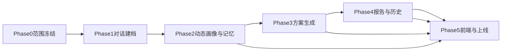

# 留学规划智能体 MVP 开发路线确认稿

**版本**：v1.0  
**依据文档**：`MVP-产品文档-留学规划智能体.md`  
**目的**：将 MVP 产品定义收敛为实际可执行的开发路线，用于研发排期、阶段验收和资源协调。

---

## 1. 开发目标确认

本次 MVP 开发只围绕一个最小闭环展开：

1. 用户注册登录
2. 与建档 Agent 开展开放式自然语言对话
3. 系统生成动态用户画像
4. 基于画像生成 1 套留学申请方案
5. 生成 1 份可在线查看的报告
6. 用户可回看历史记录

这意味着开发路线必须服务于一个核心目标：

**尽快验证用户是否愿意通过自然语言与 Agent 完成建档，并接受系统输出的画像、方案和报告。**

---

## 2. MVP 范围确认

### 2.1 本期必须交付

- 账号注册、登录、退出
- 智能对话建档能力
- 对话中断恢复
- 动态用户画像生成与查看
- 单套方案生成
- HTML 报告生成与查看
- 历史记录与基础存储
- 基础埋点与上线验收

### 2.2 本期明确不做

- 院校库搜索与筛选
- 多方案生成与方案对比
- 进度提醒
- PDF 下载
- 复杂图表体系
- 家长协同账号
- 真人顾问工作台
- 自动投递申请
- 完整多 Agent 编排后台

---

## 3. 开发路线总原则

### 3.1 顺序原则

开发顺序不能按页面来排，而应按“能力闭环”来排：

1. 先定义对话建档和画像的底层结构
2. 再打通方案与报告生成链路
3. 最后完成前端交互、历史回看与上线验证

### 3.2 架构原则

- 上游对话链路保持开放式
- 下游方案链路保持结构化输入
- 高温度 Agent 与事实确认机制必须同时建设
- MVP 先做单 Agent，不做复杂多 Agent 编排

### 3.3 交付原则

- 每一阶段都必须形成可验收输出
- 每一阶段结束都要能回答“是否更接近上线试运行”
- 不为未来平台能力过度设计当前 MVP

---

## 4. 分阶段开发路线

## Phase 0：范围冻结与技术方案定稿

### 目标

把产品定义转成研发可执行边界，避免开发过程中反复变更。

### 核心任务

- 确认 MVP 交付范围
- 确认不做项清单
- 确认对话建档系统的技术路线
- 确认画像快照与方案输入视图的结构
- 确认前后端页面与接口边界

### 交付物

- 本开发路线文档
- 智能对话建档系统架构设计
- 对话建档 Prompt 设计稿
- MVP 验收口径

### 完成标志

- 产品、研发对 MVP 能力边界达成一致
- 不再把“固定问卷”作为首发实现路径

---

## Phase 1：对话建档核心引擎

### 目标

让系统具备“能和用户对话，并逐步收集有效信息”的最核心能力。

### 核心任务

#### 1. 对话编排器

- 创建会话
- 保存消息
- 组织上下文
- 判断当前轮次是追问、总结还是确认

#### 2. Prompt 策略层

- 系统角色 Prompt
- 对话风格 Prompt
- 采集主题 Prompt
- 事实确认 Prompt
- 生成门槛 Prompt

#### 3. 建档 Agent 接口

- 接收用户输入
- 返回 Agent 回复
- 输出追问建议
- 输出缺口信息

#### 4. 会话中断恢复

- 保存对话线程
- 支持用户重新进入对话
- 恢复历史上下文

### 依赖关系

- 依赖范围冻结
- 不依赖方案生成和报告模块先完成

### 交付物

- 对话线程服务
- 基础 Agent 服务
- Prompt 配置方案
- 对话 API

### 完成标志

- 用户能够连续完成 3-5 轮以上自然对话
- Agent 可以基于上下文继续追问
- 对话关闭后重新进入可恢复

---

## Phase 2：动态画像与记忆系统

**阶段状态**：✅ 已完成（交付物与验收见 [Phase2-交付物与验收说明.md](Phase2-交付物与验收说明.md)）

### 目标

让对话结果不只是聊天记录，而是沉淀成可用画像。

### 核心任务

#### 1. 动态画像引擎

- 从对话内容抽取结构化事实
- 生成画像摘要
- 输出待补充信息
- 标记洞察与事实的边界

#### 2. 记忆系统

- 对话摘要记忆
- 实体记忆
- 长期记忆
- 向量检索索引

#### 3. 事实确认机制

- 对关键事实进行摘要回显
- 支持待确认状态
- 冲突信息标记

#### 4. 画像快照机制

- 保存当前可用画像版本
- 记录更新时间
- 为下游方案生成提供稳定输入

### 依赖关系

- 依赖 Phase 1 的对话线程和 Agent 输出

### 交付物

- 画像更新服务
- 记忆写入服务
- 画像快照表/接口
- 用户画像页基础数据接口

### 完成标志

- 用户对话后可生成画像摘要
- 画像内容与对话事实基本一致
- 下次进入系统时可基于历史记忆延续对话

---

## Phase 3：方案生成能力

### 目标

让系统基于画像生成 1 套具备基本解释性的留学方案。

### 核心任务

#### 1. 方案输入视图

- 从画像快照中提取稳定输入
- 输出学术能力、目标方向、预算、时间窗口、风险偏好等信息

#### 2. 方案生成规则

- 冲刺/匹配/保底策略
- 竞争力区间判断
- 风险提示模板
- 预算建议模板
- 时间线建议模板

#### 3. 方案生成接口

- 输入画像快照
- 返回结构化方案结果
- 返回失败原因和重试建议

### 依赖关系

- 强依赖画像快照和最低生成门槛判断

### 交付物

- 方案生成服务
- 方案结果接口
- 方案结果页接口

### 完成标志

- 系统可生成一套完整方案
- 结果至少包含冲刺/匹配/保底三档
- 页面包含免责声明与基础解释说明

---

## Phase 4：报告生成与历史记录

### 目标

把画像和方案沉淀成用户可查看的正式结果。

### 核心任务

#### 1. HTML 报告生成

- 七章模板实现
- 画像与方案数据映射
- 文本拼装与渲染

#### 2. 报告存储

- 报告内容保存
- 报告历史记录查询
- 与用户账号绑定

#### 3. 历史记录能力

- 查看历史对话
- 查看历史画像快照
- 查看历史方案
- 查看历史报告

### 依赖关系

- 依赖方案生成完成
- 依赖账号体系和基础存储

### 交付物

- 报告生成服务
- 报告详情接口
- 历史记录接口

### 完成标志

- 用户可在线查看报告
- 报告包含七章且字数达标
- 重新登录后仍能查看历史报告

---

## Phase 5：前端闭环与上线准备

### 目标

补齐用户可感知体验，完成 MVP 试运行前的收尾。

### 核心任务

#### 1. 前端核心页面

- 登录/注册页
- 智能对话建档页
- 用户画像页
- 方案结果页
- 报告详情页

#### 2. 埋点与指标

- 对话开始/中断/完成
- 关键追问命中率
- 方案生成成功/失败
- 报告查看与留存
- 满意度收集

#### 3. QA 与验收

- 核心链路回归测试
- 异常场景测试
- 权限测试
- 性能检查

### 依赖关系

- 依赖前四个阶段主要能力具备

### 交付物

- 前端完整 MVP 闭环
- 埋点面板定义
- 验收清单
- 上线检查单

### 完成标志

- 用户可完成完整闭环操作
- 关键指标可被统计
- 达到试运行标准

---

## 5. 推荐开发顺序

建议按以下真实落地顺序推进，而不是完全照页面顺序开发：

1. `Phase 0` 范围冻结
2. `Phase 1` 对话建档引擎
3. `Phase 2` 动态画像与记忆
4. `Phase 3` 方案生成
5. `Phase 4` 报告与历史记录
6. `Phase 5` 前端收口、埋点和 QA

如果资源有限，前端页面可以在 `Phase 2` 之后并行启动，但不能早于核心接口定义。

---

## 6. 模块依赖图

---

## 7. 团队分工建议

### 产品

- 维护范围边界
- 确认方案生成逻辑
- 确认报告模板与验收标准

### 算法 / AI

- 建档 Agent 行为设计
- Prompt 设计与调优
- 画像抽取与记忆写入策略
- 方案生成逻辑设计

### 后端

- 对话线程与消息服务
- 画像、记忆、方案、报告存储
- 生成接口与权限控制

### 前端

- 对话页交互体验
- 画像页可视化呈现
- 方案页与报告页渲染

### QA

- 主链路验证
- 异常链路验证
- 验收口径落地

---

## 8. 关键风险与开发控制点

| 风险 | 影响 | 控制点 |
|------|------|--------|
| 高温度 Agent 事实漂移 | 画像失真，方案不可靠 | 摘要确认、事实校验、待确认状态 |
| 对话过长导致流失 | 完成率下降 | 控制追问节奏、优先关键缺口 |
| 画像结构过于发散 | 下游方案输入不稳定 | 固定 `planInputView` |
| 报告生成过慢 | 影响体验 | 异步生成、结果落库 |
| 开发顺序错误 | 前端先行导致返工 | 坚持先能力后页面 |

---

## 9. 里程碑建议

| 里程碑 | 核心目标 | 结果 |
|--------|----------|------|
| M1 | 完成 Phase 0-1 | 系统可以对话建档 |
| M2 | 完成 Phase 2 | 系统可以形成动态画像 |
| M3 | 完成 Phase 3-4 | 系统可以生成方案和报告 |
| M4 | 完成 Phase 5 | MVP 可上线试运行 |

---

## 10. 阶段验收口径

### M1 验收

- 用户可发起建档对话
- 系统能连续多轮互动
- 会话可恢复

### M2 验收

- 对话后可生成画像
- 画像有缺口提示和更新时间
- 历史记忆可支持续聊

### M3 验收

- 基于画像能生成单套方案
- 报告可在线查看
- 历史记录可回看

### M4 验收

- 五个核心页面全部打通
- 埋点完整
- 关键性能与权限达标

---

## 11. 结论

当前 MVP 的正确开发路线，不是“先做页面，再把智能能力塞进去”，而是：

**先打通对话建档与动态画像中枢，再让方案和报告建立在稳定画像之上，最后完成前端闭环和上线验证。**

只有按这条路线推进，才能避免把“智能对话建档”做成一个表面聊天、底层仍然像问卷的伪智能产品。
