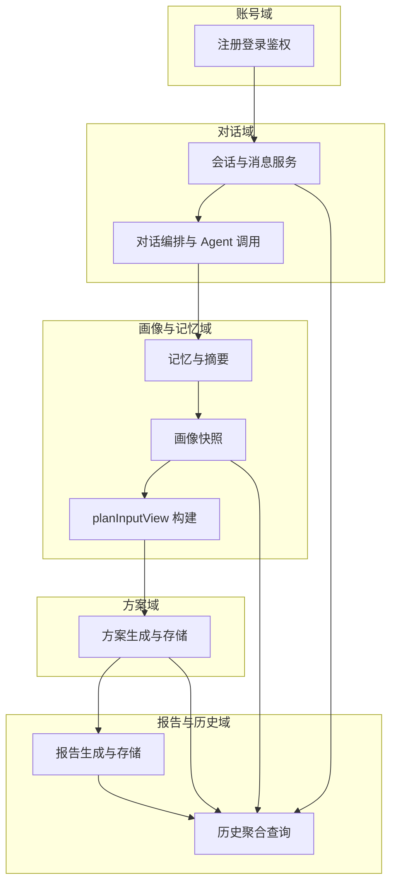

# Phase 0：服务边界与账号鉴权基线

**版本**：v1.0  
**阶段**：Phase 0  
**依据**：[智能对话建档系统架构设计.md](智能对话建档系统架构设计.md)、[MVP-完整任务拆分清单.md](MVP-完整任务拆分清单.md)  
**对应 Epic**：`P0-BE-01`、`P0-BE-02`

---

## 1. 核心模块边界

以下为逻辑服务边界，实现上可为单体多模块或微服务；职责须清晰、避免重叠。

| 模块 | 职责 | 主要输出 |
|------|------|----------|
| 会话与消息服务 | 创建会话、持久化消息、分页查询、按用户隔离 | 线程 ID、消息列表 |
| 对话编排与 Agent 调用 | 组装上下文、调用 Prompt/Agent、返回回复与状态 | Agent 回复、编排状态 |
| 记忆与摘要 | 摘要、实体、向量元数据（Phase 2 展开） | 记忆片段 |
| 画像快照 | 版本化快照、更新时间 | 快照文档 |
| planInputView 构建 | 从快照生成稳定下游视图 | `planInputView` |
| 方案生成与存储 | 输入视图 → 结构化方案、落库 | 方案结果 |
| 报告生成与存储 | 画像+方案 → HTML 报告、落库 | 报告内容 |
| 历史聚合查询 | 对话/画像/方案/报告列表与详情 | 历史 API |
| 注册登录鉴权 | 身份、会话令牌、权限校验 | 用户身份上下文 |

**原则**：方案与报告**不**直接读原始对话全文；**经**快照与 `planInputView`（及方案结果）衔接。

---

## 2. 最小接口边界（按阶段）

### 2.1 Phase 1 优先暴露（对话闭环）

| 能力 | 方向 | 说明 |
|------|------|------|
| 创建会话 | 客户端 → 服务端 | 与用户绑定 |
| 发送消息 / 获取回复 | 双向 | 经编排与 Agent |
| 历史消息分页 | 客户端 ← 服务端 | 支持恢复 |
| 会话恢复 | 客户端 → 服务端 | 再次进入同一线程 |

表字段级定义在接口设计阶段展开；Phase 0 仅冻结**能力范围**。

### 2.2 Phase 2–4 只读/写入方向（概念）

| 能力 | 阶段 |
|------|------|
| 画像快照读 | Phase 2+ |
| `planInputView` 读 | Phase 2+（构建服务产出后） |
| 方案结果读写 | Phase 3 |
| 报告读写、历史聚合 | Phase 4 |

---

## 3. 账号与鉴权基线

| 项 | MVP 基线 |
|----|----------|
| 能力 | 注册、登录、退出 |
| 数据归属 | 所有对话线程、画像快照、方案、报告**必须**与用户账号绑定 |
| 隔离 | 用户 A 不可访问用户 B 的任何上述数据（越权为 P0 缺陷） |
| 实现选型 | Phase 0 不锁定具体 OAuth/JWT/Session 实现；由后端在 Phase 1 前确定**一种**与前端约定一致（见 [MVP-完整任务拆分清单.md](MVP-完整任务拆分清单.md) `X-02` 环境管理） |
| 安全 | 传输 HTTPS；敏感配置走环境变量；不在客户端存储长期明文密钥 |

---

## 4. Phase 0 验收

| # | 验收项 |
|---|--------|
| 1 | 各模块职责无重复、主路径无遗漏 |
| 2 | Phase 1 API 能力范围已共识 |
| 3 | 账号绑定与隔离原则已书面确认 |
