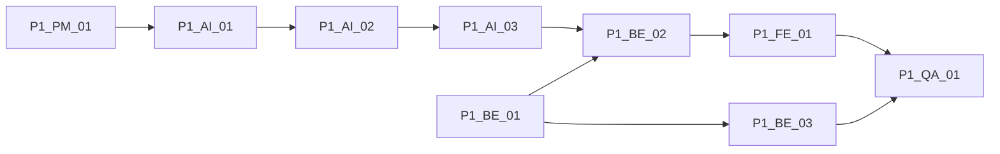

# Phase 1：对话建档核心引擎 — 完整细分任务清单

**版本**：v1.0  
**阶段**：Phase 1  
**依据**：[MVP-完整任务拆分清单.md](MVP-完整任务拆分清单.md)、[MVP-开发路线确认稿.md](MVP-开发路线确认稿.md)、[智能对话建档系统架构设计.md](智能对话建档系统架构设计.md)、[对话建档Prompt设计稿.md](对话建档Prompt设计稿.md)、[Phase0-画像快照与planInputView契约.md](Phase0-画像快照与planInputView契约.md)

**实现状态**：工程实现已完成（后端 `backend/`、前端 `frontend/`、自动化测试 `npm test`）。联调说明见 [Phase1-API-联调说明.md](Phase1-API-联调说明.md)；UX 原则见 [Phase1-对话状态与UX原则说明.md](Phase1-对话状态与UX原则说明.md)。

---

## 1. 阶段目标、依赖与验收

| 维度 | 内容 |
|------|------|
| **阶段目标** | 系统具备多轮自然语言建档能力：**会话管理、Prompt 策略、建档 Agent、中断恢复**。 |
| **阶段依赖** | Phase 0 已完成（范围、契约、技术路线已定稿）。 |
| **架构映射** | `ConversationUI`（接口契约）、`DialogueOrchestrator`、`PromptStrategyLayer`、`ProfileAgent`（对话侧）。 |
| **阶段验收** | 用户可发起建档对话；多轮互动；会话可恢复。 |
| **补充完成标志**（路线稿） | 连续 **3–5 轮**以上自然对话；Agent 可基于上下文**继续追问**；关闭对话后重新进入**可恢复**。 |

### 与 Phase 2 的边界（本阶段不做）

| 不做 / 不深做 | 说明 |
|---------------|------|
| 长期语义记忆增强、向量召回 | 属 Phase 2 |
| 独立「关键事实确认卡片」UI | 可后置；Phase 1 可用对话内回显满足最小确认约束 |
| 画像快照深度写入、记忆写入策略全量落地 | Phase 2 `P2-AI-*` |
| 多 Agent 编排平台 | 维持单 Agent 主路径，见 Phase 0 技术路线 |

---

## 2. 规划边界（Phase 1 范围内）

- 会话线程、消息持久化、分页历史。
- 对话编排器、Prompt 五层策略、单 Agent 建档链路。
- 编排状态机与 readiness 门槛的**最小可运行**规则。
- 会话中断恢复 API 与前端对话页 MVP（API 联调优先）。
- 主链路测试与异常场景覆盖。

---

## 3. 按 Epic 拆分的任务包

以下为可分配负责人、可验收的**任务项**；编号便于导入项目管理工具。

### 3.1 产品 `P1-PM-01`：对话状态与用户体验原则

| 任务 ID | 任务描述 | 交付/验收 |
|---------|----------|-----------|
| P1-PM-01-T1 | 定义单轮追问数量上限、追问节奏、问题优先级原则 | 写入 UX 原则文档 |
| P1-PM-01-T2 | 明确「继续追问」vs「总结确认」的切换条件 | 与编排状态机可对齐 |
| P1-PM-01-T3 | 规定 readiness 未达标时的提示语气与交互原则 | 与 Prompt `readiness` 一致 |
| P1-PM-01-T4 | 补充「自然对话优先、避免问卷感」反模式 | 与 [对话建档Prompt设计稿.md](对话建档Prompt设计稿.md) 不冲突 |
| P1-PM-01-T5 | 评审定稿《对话状态与 UX 原则说明》 | 产品签字或纪要 |

**Epic 交付物**：对话状态与 UX 原则说明。

---

### 3.2 AI `P1-AI-01`：Prompt 策略层落地

| 任务 ID | 任务描述 | 交付/验收 |
|---------|----------|-----------|
| P1-AI-01-T1 | 固定最小五层：`system`、`style`、`collection`、`confirmation`、`readiness` | 分层表 |
| P1-AI-01-T2 | 明确每层职责、输入上下文、输出目标 | 分层说明 |
| P1-AI-01-T3 | Prompt 配置存储、版本号、回滚策略 | 可独立调参、可回滚 |
| P1-AI-01-T4 | 运行时组装策略：普通追问 / 事实确认 / 门槛判断 | 组装规则文档 |
| P1-AI-01-T5 | 标注 Phase 1 必做层与后续可扩展层 | 边界清晰 |

**Epic 交付物**：Prompt 配置方案、分层说明、版本管理规则。

---

### 3.3 AI `P1-AI-02`：建档 Agent 核心逻辑

| 任务 ID | 任务描述 | 交付/验收 |
|---------|----------|-----------|
| P1-AI-02-T1 | 定义单 Agent 主链路输入输出（含错误语义） | 接口约定 |
| P1-AI-02-T2 | 每轮至少产出：回复文本、追问建议、缺口信息（或等价结构化字段） | 与验收样例可对照 |
| P1-AI-02-T3 | 高温度主对话 + 低温度结构化判断的协作方式 | 与 Phase 0 双链路一致 |
| P1-AI-02-T4 | Phase 1 最小「事实 vs 洞察」规则，禁止推断默认落为硬事实 | 与 `planInputView` 契约不冲突 |
| P1-AI-02-T5 | 准备 3–5 轮示例对话脚本，作为调参与抽检用例 | 样例集 |

**Epic 交付物**：Agent 服务或链、输入输出约定、样例对话集。

---

### 3.4 AI `P1-AI-03`：对话编排状态机

| 任务 ID | 任务描述 | 交付/验收 |
|---------|----------|-----------|
| P1-AI-03-T1 | 固化状态：`Init`、`Explore`、`GapProbing`、`FactConfirmation`、`ProfileReady`（与架构一致） | 状态图 |
| P1-AI-03-T2 | 每状态进入/退出条件、合法转移 | 转移表 |
| P1-AI-03-T3 | 缺口判断与 readiness 门槛的最小规则 | 与 `P1-AI-01` readiness 对齐 |
| P1-AI-03-T4 | 编排器 vs Agent 职责边界（状态判断不全部塞进 Prompt） | 说明文档 |
| P1-AI-03-T5 | 输出状态机说明，供后端 API 与 QA 用例引用 | 可评审 |

**Epic 交付物**：状态机说明 + 实现接口（编排层可消费的状态标识）。

---

### 3.5 后端 `P1-BE-01`：对话线程与消息存储

| 任务 ID | 任务描述 | 交付/验收 |
|---------|----------|-----------|
| P1-BE-01-T1 | 会话线程模型：创建、归属用户、状态、更新时间 | 模型说明 |
| P1-BE-01-T2 | 消息模型：用户/Agent、时间序、分页 | 模型说明 |
| P1-BE-01-T3 | API：创建会话、追加消息、分页查询历史 | 消息不丢、按用户隔离 |
| P1-BE-01-T4 | 权限与数据隔离：仅本人可访问本人线程 | 与安全用例一致 |
| P1-BE-01-T5 | 文档：线程与消息 API 说明 | 供前端联调 |

**Epic 交付物**：线程与消息 API、最小数据模型、权限约束说明。

---

### 3.6 后端 `P1-BE-02`：对话编排与 Agent 调用编排服务

| 任务 ID | 任务描述 | 交付/验收 |
|---------|----------|-----------|
| P1-BE-02-T1 | 主对话 API：接收用户输入、返回 Agent 回复与编排状态 | 端到端可调通 |
| P1-BE-02-T2 | 上下文组装：最近消息、会话元信息、Prompt 分层输入 | 与 `P1-AI-01` 一致 |
| P1-BE-02-T3 | 接入状态机：响应中带当前状态/可消费状态标识 | 与 `P1-AI-03` 一致 |
| P1-BE-02-T4 | 预留缺口、下一问建议等字段（供前端/Phase 2） | 契约稳定 |
| P1-BE-02-T5 | 联调说明：与 Agent 服务对接方式、超时与重试 | 文档 |

**Epic 交付物**：编排服务 API、上下文组装规则、联调说明。

---

### 3.7 后端 `P1-BE-03`：会话中断恢复

| 任务 ID | 任务描述 | 交付/验收 |
|---------|----------|-----------|
| P1-BE-03-T1 | 按线程 ID 恢复：返回历史消息（分页） | 与 `P1-BE-01` 一致 |
| P1-BE-03-T2 | 恢复响应最小集：消息列表、会话状态、最近更新时间 | 前端可渲染 |
| P1-BE-03-T3 | 异常：无效线程、越权、空线程 | 错误码与文案 |
| P1-BE-03-T4 | 验证：关闭页面后再次进入可续聊 | 与 QA 用例通过 |

**Epic 交付物**：恢复接口与逻辑、异常场景定义。

---

### 3.8 前端 `P1-FE-01`：对话页 MVP

| 任务 ID | 任务描述 | 交付/验收 |
|---------|----------|-----------|
| P1-FE-01-T1 | 壳层：消息列表、输入区、发送、加载态 | 可演示 |
| P1-FE-01-T2 | 接入：创建会话、发消息、拉历史、恢复 | 对接 `P1-BE-*` |
| P1-FE-01-T3 | 多轮展示、基础错误态与重试 | 主路径可用 |
| P1-FE-01-T4 | 刷新/重进页面后历史回显 | 与恢复 API 一致 |
| P1-FE-01-T5 | 明确 Phase 1 不做复杂视觉与独立确认卡片 | 范围可控 |

**Epic 交付物**：对话页组件、联调说明、错误态与加载态定义。

---

### 3.9 QA `P1-QA-01`：对话主链路用例

| 任务 ID | 任务描述 | 交付/验收 |
|---------|----------|-----------|
| P1-QA-01-T1 | 基于 [Phase0-主链路测试框架.md](Phase0-主链路测试框架.md) 扩展 Phase 1 专项用例 | 用例表 |
| P1-QA-01-T2 | 主路径：建会话、连续多轮、关闭重进恢复 | 可执行 |
| P1-QA-01-T3 | 异常：网络失败、空历史、无效线程、越权 | 可执行 |
| P1-QA-01-T4 | 验收：3–5 轮连贯、追问存在、无明显问卷感、恢复后可发消息 | 检查项 |

**Epic 交付物**：Phase 1 用例集、验收检查项、回归建议。

---

## 4. 推荐执行顺序

1. `P1-PM-01`：冻结 UX 原则，减少 Prompt 与产品偏差。  
2. **并行**：`P1-AI-01`（Prompt 结构）与 `P1-BE-01`（线程/消息底座）。  
3. `P1-AI-02`：单 Agent 可运行链路（依赖 `P1-AI-01`）。  
4. `P1-AI-03`：状态机与门槛（依赖 `P1-AI-02`）。  
5. `P1-BE-02`：编排 API（依赖 `P1-BE-01`，`P1-AI-02`）。  
6. **并行**：`P1-BE-03`（恢复，依赖 `P1-BE-01`）可与 `P1-BE-02` 后半段并行。  
7. `P1-FE-01`：对话页联调（依赖 `P1-BE-02` 稳定）。  
8. `P1-QA-01`：主链路 + 异常回归。

---

## 5. 关键路径与并行关系

**说明**：`P1-BE-01` 与 `P1-AI-01` 可并行启动；`P1-BE-02` 需等待 `P1-AI-02`；`P1-BE-03` 仅依赖 `P1-BE-01`，但「关闭再进可续聊」的整体验收需与 `P1-FE-01` 一起测。

---

## 6. 风险与控制点

| 风险 | 控制 |
|------|------|
| Prompt 分层未固定即开发 Agent | 先完成 `P1-AI-01` 再展开 `P1-AI-02` |
| 状态机职责不清 | 编排器承担转移，避免全部塞进 Prompt |
| 前端在编排 API 未稳前做满交互 | 优先 API 联调版，与 [MVP-完整任务拆分清单.md](MVP-完整任务拆分清单.md) 一致 |
| 恢复场景未定义异常 | `P1-BE-03` 明确无效/越权/空线程 |
| 范围蔓延到 Phase 2 | 以本文第 1 节边界为准，画像/记忆深化一律进 Phase 2 |

---

## 7. Phase 1 完成定义（文档级）

- 本清单中各 Epic 任务项均已分配或进入执行，且关键路径无阻塞项未认领。  
- 实现阶段验收与路线稿完成标志一致后，将 [MVP-完整任务拆分清单.md](MVP-完整任务拆分清单.md) 中 Phase 1 标记为已完成，并进入 Phase 2。

---

## 8. 项目管理导入建议列

将任务拆为表格行时可使用：

`任务ID`、`任务描述`、`负责人`、`优先级`、`预计工期`、`前置依赖`、`状态`。

---

## 附录：Epic 与任务 ID 对照

| Epic ID | 任务 ID 前缀 |
|---------|----------------|
| P1-PM-01 | P1-PM-01-T* |
| P1-AI-01 | P1-AI-01-T* |
| P1-AI-02 | P1-AI-02-T* |
| P1-AI-03 | P1-AI-03-T* |
| P1-BE-01 | P1-BE-01-T* |
| P1-BE-02 | P1-BE-02-T* |
| P1-BE-03 | P1-BE-03-T* |
| P1-FE-01 | P1-FE-01-T* |
| P1-QA-01 | P1-QA-01-T* |
