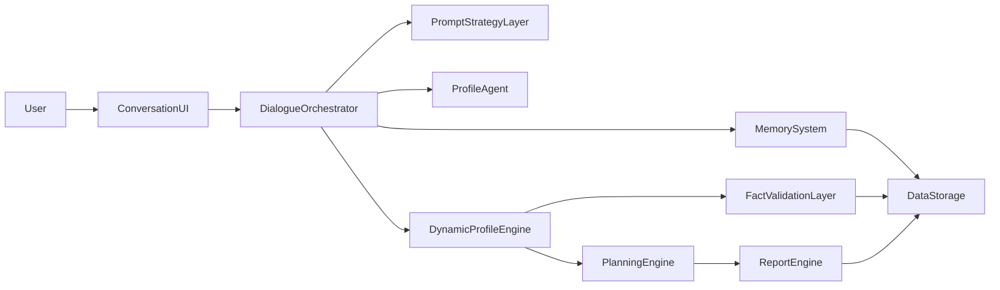
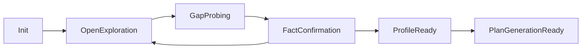
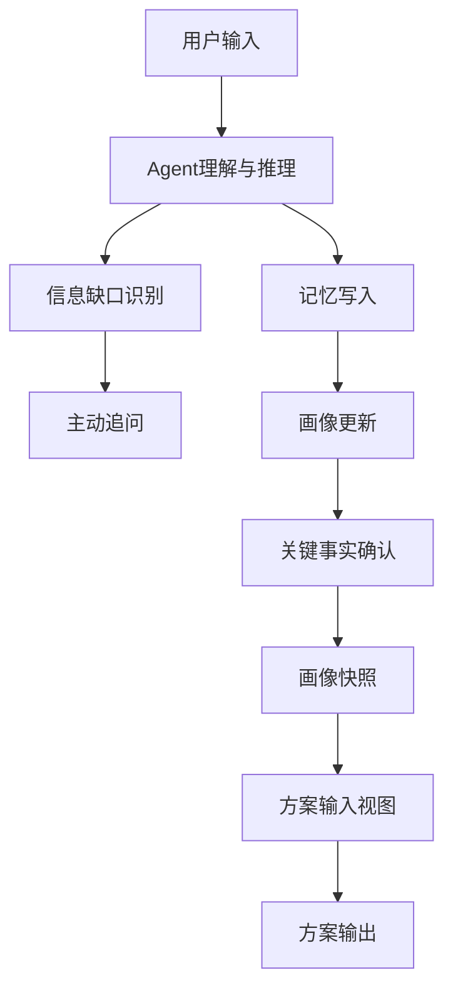

# 留学规划智能体智能对话建档系统架构设计

**版本**：v1.0  
**对应产品文档**：`PRD-留学规划智能体.md`、`MVP-产品文档-留学规划智能体.md`  
**目标**：定义“注册登录 -> 智能对话建档 -> 动态用户画像 -> 方案生成”的系统架构与模块边界。

---

## 1. 文档目标

本文档用于回答以下问题：

1. 智能对话建档系统由哪些核心模块组成
2. Agent 如何替代固定问卷完成信息采集
3. 动态用户画像如何构建、存储、更新和供下游使用
4. 记忆系统如何支持跨会话延续
5. MVP 阶段应如何裁剪实现范围

---

## 2. 设计原则

### 2.1 产品原则

- 不以“填表效率”为核心，而以“自然表达 + 专业引导 + 深度理解”为核心
- 不要求用户按预设顺序回答问题
- 不把用户画像限制为固定字段模板
- 不把 Agent 当成聊天 UI，而是当成建档引擎

### 2.2 技术原则

- 对话层、记忆层、画像层、方案层解耦
- Prompt 负责约束行为，Memory 负责维持连续性，Profile 负责沉淀事实与洞察
- 高温度用于提升洞察和表达，但关键事实写入必须受控
- 方案生成依赖“画像快照”，而不是直接消费原始对话全文

---

## 3. 总体架构

---

## 4. 核心模块拆解

## 4.1 Conversation UI

### 职责

- 承载用户与建档 Agent 的自然语言对话
- 展示当前对话状态、画像摘要、待补充信息
- 提供中断恢复、历史消息查看、关键摘要确认

### 输入

- 用户文本输入
- 用户上传材料（后续版本）

### 输出

- 对话消息
- 用户确认动作
- 关键事实修正动作

### MVP 范围

- 文本对话
- 历史消息回显
- 中断恢复
- 关键摘要确认卡片

---

## 4.2 Dialogue Orchestrator

### 职责

对话编排器是整套系统的中枢，负责：

- 管理对话状态机
- 决定当前轮次是继续追问、总结确认、还是允许进入方案生成
- 调用 Prompt 策略层、Agent、记忆系统和画像引擎

### 关键能力

- 会话初始化
- 上下文组装
- 多轮状态切换
- 信息缺口判断
- 关键事实确认
- 生成门槛判断

### 建议状态机

---

## 4.3 Prompt Strategy Layer

### 职责

Prompt 策略层不是单个 Prompt，而是一组分层策略：

- 系统角色定义
- 建档目标定义
- 核心采集主题清单
- 追问规则
- 高温度表达边界
- 禁止行为与合规约束

### 作用

- 将原来“固定问卷”的维度隐式封装进 Agent 能力，而不是显式暴露成表单
- 保证开放式对话仍然能收敛到可用画像

### 分层建议

1. `systemPrompt`
2. `profileCollectionPolicy`
3. `memoryWritePolicy`
4. `factConfirmationPolicy`
5. `planReadinessPolicy`

---

## 4.4 Profile Agent

### 职责

Profile Agent 是与用户直接交互的核心智能体，负责：

- 理解用户自然语言表达
- 识别显式事实与隐含偏好
- 发起澄清、追问与结构化总结
- 输出专业、有洞察的建档互动体验

### 模型策略

- 建议 `temperature 0.7-0.9`
- 对“追问与洞察表达”使用高温度
- 对“事实确认与画像写入”使用低温度子链路或规则校验

### 行为边界

- 不直接凭空补全事实
- 不因高温度而擅自做录取承诺
- 不在画像未成熟时过早生成方案结论

---

## 4.5 Memory System

记忆系统分为 4 层，不同层负责不同类型的信息。

### A. ShortTermContext

用于当前对话窗口的近距离上下文，保证本轮回答连续自然。

### B. ConversationSummaryMemory

将长对话压缩为阶段性摘要，避免上下文无限增长。

### C. EntityMemory

保存稳定实体及其属性，例如：

- 用户
- 目标国家/地区
- 目标专业
- 预算约束
- 家庭决策角色
- 风险偏好

### D. LongTermSemanticMemory

以向量形式保存非结构化记忆，用于后续召回：

- 个人动机
- 对城市生活方式的偏好
- 家庭对费用的敏感度
- 对跨专业路径的真实态度

### 设计原则

- 消息不等于记忆
- 只有经过策略判断的信息才写入长期记忆
- 关键事实应可追溯到对话证据

---

## 4.6 Dynamic Profile Engine

### 职责

将对话和记忆加工为“可读、可检索、可演化”的动态用户画像。

### 画像三层结构

#### 第一层：结构化事实层

示例：

- 学历背景
- GPA/成绩体系
- 语言成绩
- 标化成绩
- 专业方向
- 预算区间
- 申请时间窗口

#### 第二层：洞察与偏好层

示例：

- 选校风险偏好偏稳健
- 对城市资源重视高于气候偏好
- 家庭预算敏感但可接受奖学金驱动型高投入
- 对跨专业有意愿但需要桥梁项目

#### 第三层：记忆与语义层

示例：

- 用户在多个回合提到想去国际化都市
- 家长更关注就业结果而非学术排名
- 用户对申请时间紧迫感较强

### 输出形式

- `profileSnapshot`
- `missingInfoList`
- `confidenceSignals`
- `insightSummary`
- `planInputView`

### 关键原则

- 画像不是固定 JSON 模板，但可输出稳定的“下游消费视图”
- 对上游保持开放，对下游保持收敛

---

## 4.7 Fact Validation Layer

### 职责

在高温度对话之上建立“事实写入安全层”。

### 核心能力

- 识别用户明确陈述的事实
- 标记推断性结论和确定性事实的边界
- 在关键节点向用户回显并确认
- 阻止低置信度内容进入方案输入

### 建议验证点

- 学历/院校/专业
- GPA 或分数体系
- 语言成绩
- 目标学位与时间
- 预算约束
- 国家/地区偏好

---

## 4.8 Planning Engine

### 职责

基于画像快照生成留学方案，而不是直接读取全量对话。

### 输入

- `planInputView`
- 画像置信度
- 缺失信息清单
- 风险偏好

### 输出

- 冲刺/匹配/保底梯度
- 录取竞争力区间
- 时间规划建议
- 预算建议
- 风险与备选路径

### 进入条件

只有当画像达到最低可用门槛时才允许触发方案生成。

---

## 4.9 Report Engine

### 职责

- 将画像快照和方案输出组织为正式报告
- 负责章节模板填充、语言润色与渲染输出

### 数据来源

- 动态画像摘要
- 方案结构化输出
- 风险与时间规划结果

---

## 5. 关键数据流

---

## 6. 画像存储设计

## 6.1 建议存储对象

- `conversation_thread`
- `conversation_message`
- `conversation_summary`
- `entity_memory`
- `semantic_memory_index`
- `profile_snapshot`
- `profile_change_log`
- `plan_input_view`

## 6.2 读写原则

- 原始消息完整保存
- 摘要按阶段生成
- 实体记忆按增量更新
- 画像快照按版本保存
- 方案生成只读最近可用快照

---

## 7. MVP 架构裁剪

MVP 不需要一步做到“复杂多 Agent 平台”，建议只保留最小实现：

### 保留

- 单一建档 Agent
- 对话编排器
- 摘要记忆
- 基础实体记忆
- 动态画像快照
- 方案输入视图

### 延后

- 多 Agent 协同
- 自动工具调用编排平台
- 复杂记忆图谱编辑界面
- 多模态材料理解
- 自动外部数据校验

---

## 8. 技术实现建议

## 8.1 LangChain 式实现思路

虽然不强依赖某个框架，但建议采用 LangChain 式分层：

- `LLMChain`：对话回复、摘要、画像更新
- `Router`：判断当前轮次任务类型
- `Memory`：短期 + 摘要 + 实体 + 向量记忆
- `OutputParser`：把开放式对话收敛为稳定的画像更新事件
- `Guardrail`：控制事实写入和生成门槛

## 8.2 推荐链路

1. 用户发言进入 Orchestrator
2. Orchestrator 组装短期上下文 + 摘要 + 实体记忆
3. Agent 生成回复与追问
4. 解析用户事实、偏好、实体与洞察
5. 通过 Validation Layer 筛选可写入内容
6. 更新画像快照
7. 判断是否达到方案生成门槛

---

## 9. 风险与控制点

| 风险 | 说明 | 控制点 |
|------|------|--------|
| 高温度漂移 | Agent 可能过度推断 | 关键事实确认、低温度写入链路 |
| 对话失控 | 对话过于发散，难以收敛 | Prompt 策略层 + 缺口识别 + 生成门槛 |
| 长上下文膨胀 | 多轮对话成本过高 | 分阶段摘要 + 记忆分层 |
| 画像污染 | 模糊推断进入下游 | Validation Layer + 置信度标记 |
| 方案输入不稳定 | 下游无法消费开放式画像 | 输出固定 `planInputView` |

---

## 10. 对下游模块的接口约束

为了避免“开放式画像”影响后续系统稳定性，建议定义固定的下游消费接口。

### 10.1 对方案生成模块

输入必须来自 `planInputView`，至少包含：

- 学术能力摘要
- 语言与标化状态
- 目标国家/地区偏好
- 目标专业与学位方向
- 预算约束
- 时间窗口
- 风险偏好
- 关键不确定项

### 10.2 对报告模块

输入必须来自：

- 最新画像快照
- 最新方案结果
- 风险与时间规划数据

---

## 11. 上线顺序建议

### Phase 1

- 单 Agent 对话建档
- 对话摘要
- 动态画像快照
- 方案输入视图

### Phase 2

- 长期记忆增强
- 实体记忆细化
- 关键事实确认卡片

### Phase 3

- 新维度自动发现优化
- 多轮记忆检索优化
- 材料上传与对话联动

---

## 12. 一句话结论

这套系统的核心不是“把问卷改成聊天框”，而是构建一个以 Agent 为核心、以记忆为支撑、以动态画像为中枢、以方案生成为目标出口的智能建档架构；上游必须保持开放自然，下游必须保持稳定可消费。
