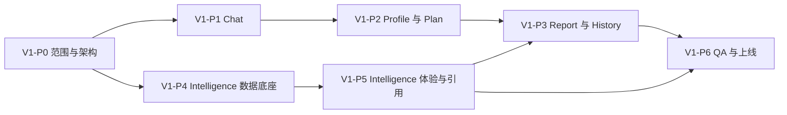

# V1：留学规划交付与情报版开发路线清单

**版本**：v1.0  
**依据**：`C:\Users\zhaoy\.cursor\plans\v1_交付产品化_b7d951f1.plan.md`  
**定位**：将当前跑通型 MVP 升级为可对外试用的 V1 产品版本。V1 不只补报告页，而是围绕专业建档、申请档案、申请策略、正式报告、交付物中心和香港留学情报知识库六个 tab 完成整体产品化。

---

## 1. V1 总目标

V1 的目标是让用户完成一次完整、可信、可交付的留学规划体验：

1. 在 `Chat` 中获得简洁、精准、专业的建档反馈。
2. 在 `Profile` 中看到可信申请档案，理解哪些事实已确认、哪些仍缺失。
3. 在 `Plan` 中理解冲刺、匹配、保底策略及其依据。
4. 在 `Report` 中获得短、准、专业但通俗的正式报告，支持在线查看、PDF 下载和公开链接分享。
5. 在 `History` 中管理历史报告、分享状态和下载入口。
6. 在 `Intelligence` 中查阅 2023 至 2026 年香港留学情报，看到来源链接、变化时间线、院校/专业更新和与自己相关的提醒。

---

## 2. V1 范围边界

### 2.1 必须交付

- 六个业务 tab：`Chat`、`Profile`、`Plan`、`Report`、`History`、`Intelligence`。
- Chat 专业顾问式回答：判断、原因、下一步，避免冗余。
- 申请档案与申请策略页的可信依据展示。
- 短篇正式报告、PDF 导出、公开分享链接、分享关闭能力。
- 交付物中心：报告版本、下载、分享状态、历史回看。
- 香港留学情报知识库：院校优先、全量覆盖目标、八大深度覆盖、其他院校基础覆盖。
- 情报每日更新、来源链接、来源类型、发布时间、中文翻译、2023-2026 变化时间线。
- AI 引用知识库事实时必须显示来源。
- 情报首页仪表盘、院校详情页、混合搜索、关注与相关提醒。
- V1 级 QA、验收清单和上线检查。

### 2.2 本期不做

- 多方案对比器。
- 支付、订阅、商业转化漏斗。
- 真人顾问后台、顾问 CRM、家长独立账号。
- 自动网申、自动投递、材料代填。
- 完整院校排名模型或复杂推荐算法。
- 将情报知识库包装成替代官网的最终解释来源。
- 强打扰推送，如短信、邮件、微信服务号提醒。V1 只做站内提醒。

---

## 3. 整体项目结构更新

当前项目以 MVP 阶段验收为主，前后端核心逻辑较集中。V1 建议按业务边界拆出更清晰的模块，但不强制一次性迁移到大型框架。

### 3.1 后端建议结构

```text
backend/
  src/
    app.js                         # Fastify 组装入口，逐步瘦身为路由注册
    index.js                       # 服务启动入口
    store.js                       # MVP JSON 存储，V1 可先扩展再准备 DB 迁移
    modules/
      chat-advisor/
        prompt-policy.js           # Chat 专业顾问式输出规范
        readiness-service.js       # 建档进度与报告准备状态
      profile-dossier/
        dossier-service.js         # 申请档案、事实状态、缺失项
      planning-strategy/
        strategy-service.js        # 申请策略、风险、预算、时间线依据
      report-delivery/
        report-template.js         # 短报告模板与通俗表达规则
        pdf-service.js             # PDF 导出
        share-service.js           # 公开分享链接、关闭分享
      history-center/
        delivery-service.js        # 交付物版本、下载、分享状态
      intelligence/
        source-registry.js         # 官方/媒体/教育平台来源白名单
        ingestion-service.js       # 每日采集任务
        normalization-service.js   # 中文翻译、摘要、标签、去重
        review-service.js          # 媒体/教育平台审核流
        knowledge-store.js         # 情报条目、时间线、来源链接
        search-service.js          # 混合搜索与筛选
        citation-service.js        # Chat/Plan/Report 引用来源
        alert-service.js           # 关注对象与画像相关提醒
    prompts/
      v1/
        chat-advisor.txt           # 简洁专业顾问式回答
        report-style.txt           # 短、准、专业但通俗
        intelligence-citation.txt  # 所有知识库事实必须引用来源
```

### 3.2 前端建议结构

```text
frontend/
  src/
    main.js                        # V1 初期可保留路由入口，逐步拆页
    api/
      client.js                    # 统一 API 封装
      intelligence.js              # 情报 API
      reports.js                   # 报告、PDF、分享 API
    pages/
      ChatPage.js
      ProfilePage.js
      PlanPage.js
      ReportPage.js
      HistoryPage.js
      IntelligencePage.js
    components/
      chat/
      profile/
      plan/
      report/
      history/
      intelligence/
        IntelligenceDashboard.js
        SchoolCardGrid.js
        SchoolDetail.js
        IntelligenceCard.js
        IntelligenceSearch.js
        RelatedAlertsPanel.js
```

### 3.3 文档结构建议

```text
docs/
  v1.verson/
    README.md
    V1-开发路线清单.md
    V1-具体任务完成清单.md
```

MVP 阶段文档建议保留为历史参考，不再作为 V1 决策入口。

---

## 4. 全阶段任务概览

| Phase | 名称 | 目标 | 核心交付 |
|------|------|------|----------|
| V1-P0 | 范围冻结与架构基线 | 锁定 V1 六 tab 范围、项目结构、数据契约和验收标准 | V1 规格、路由与 API 草案、数据模型草案、任务清单 |
| V1-P1 | Chat 专业建档顾问 | 让 Chat 回答短、准、专业，具备建档进度和报告准备状态 | Prompt 规则、建档进度、缺口提示、事实确认 |
| V1-P2 | Profile 与 Plan 产品化 | 让画像和方案从展示页升级为可信申请档案与申请策略页 | 事实状态、来源说明、策略依据、风险预算时间线 |
| V1-P3 | Report 与 History 交付产品化 | 完成短报告、PDF、公开分享、交付物中心 | 短报告模板、PDF、分享链接、报告版本 |
| V1-P4 | Intelligence 数据底座 | 建立香港留学情报采集、清洗、审核、归档与来源系统 | 来源白名单、每日更新、审核流、时间线数据 |
| V1-P5 | Intelligence 产品体验与 AI 引用 | 完成情报仪表盘、院校页、混合搜索、提醒和严格引用 | 情报页、搜索、提醒、引用来源 |
| V1-P6 | 全链路 QA 与上线准备 | 完成六 tab 回归、权限、安全、性能、数据质量和上线检查 | QA 用例、验收报告、上线检查单 |

---

## 5. 阶段依赖关系



说明：

- `Intelligence` 数据底座可以与 `Chat`、`Profile`、`Plan` 并行启动。
- `Report` 的严格引用依赖 `Intelligence` 的来源与引用能力。
- 全链路验收必须覆盖六个 tab，不能只验收报告交付。

---

## 6. 阶段验收标准

### V1-P0：范围冻结与架构基线

- V1 六 tab 范围明确，所有不做项已写入文档。
- 后端模块边界、前端页面边界、核心数据模型、API 草案完成评审。
- `Intelligence` 被明确为独立子系统，而不是普通资讯列表。
- 任务清单可以直接进入研发排期。

### V1-P1：Chat 专业建档顾问

- Chat 每轮回答遵循“判断 + 原因 + 下一步”。
- 单轮追问最多 1-2 个关键问题。
- 页面能展示建档进度、关键信息缺口、事实确认和报告准备状态。
- 用户输入足够时，Chat 能输出短诊断，而不是继续机械追问。

### V1-P2：Profile 与 Plan 产品化

- Profile 能区分用户明确事实、系统推断、待确认事实和缺失项。
- Plan 能解释冲刺、匹配、保底的策略依据。
- 预算、时间线、风险提示可被 Report 引用。
- 用户和家长能理解“为什么系统这样建议”。

### V1-P3：Report 与 History 交付产品化

- Report 不设字数下限，内容简洁、专业、通俗。
- Report 支持在线查看、PDF 下载、公开长随机链接分享和关闭分享。
- 分享页有隐私提示，不要求家长登录。
- History 能管理报告版本、PDF 下载、分享状态和历史回看。

### V1-P4：Intelligence 数据底座

- 建立官方、权威媒体、教育平台三类来源管理。
- 官方来源可自动发布；非官方权威来源进入审核或弱标识展示。
- 情报条目包含标题、摘要、适用对象、来源类型、发布时间、原文链接、院校、学位、专业、信息类型。
- 支持每日更新、去重、归档和 2023-2026 时间线。

### V1-P5：Intelligence 产品体验与 AI 引用

- 情报 tab 首页为仪表盘，包含个性化更新、院校入口、重要变更和搜索。
- 院校详情页采用“院校概览 + 最新情报”结构。
- 搜索支持关键词、筛选器、AI 摘要和来源引用。
- Chat、Plan、Report 使用知识库事实时必须显示来源。
- 支持 tab 徽标、院校卡片更新标记、“与你相关”面板和关注对象提醒。

### V1-P6：全链路 QA 与上线准备

- 六个 tab 主链路无 P0/P1 阻塞。
- 报告分享、PDF、历史、情报检索、AI 引用均有回归用例。
- 情报数据质量、来源链接可用性、翻译可读性、审核状态展示通过抽样验收。
- 权限、越权、公开分享、限流、错误恢复均通过测试。

