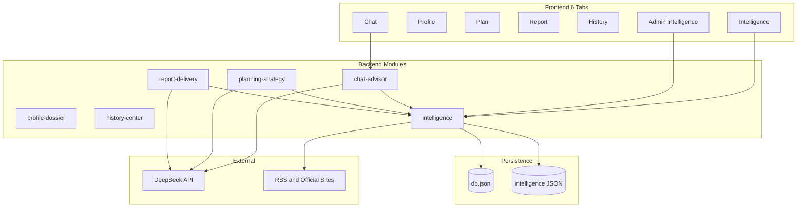

# V1 迭代路线图

**版本**：v1.0  
**更新日期**：2026-05-28（Sprint 1–7 完成，M4 达成）  
**依据**：[`.cursor/plans/v1_迭代路线图_d8ab1e3a.plan.md`](../../.cursor/plans/v1_迭代路线图_d8ab1e3a.plan.md)  
**关联文档**：[V1-开发路线清单.md](V1-开发路线清单.md)、[V1-具体任务完成清单.md](V1-具体任务完成清单.md)、[V1-API-草案.md](V1-API-草案.md)

---

## 需求确认摘要（Brainstorming）

| 维度 | 选择 |
|------|------|
| 核心目标 | 恢复完整 V1，重新实现 **Intelligence 知识库** |
| Intelligence 范围 | 用户浏览/搜索、AI 引用、数据采集流水线、运营审核后台（**不含**站内提醒） |
| 部署目标 | **云服务器试点**（Docker、HTTPS、数据备份） |
| 周期 | **约 8 周** |
| 现有 5 Tab 优化 | 乱码修复、文档对齐、前后端模块化、人工 QA、AI 质量、UX 打磨 |

**推荐方案**：方案 B — 后端优先并行（Week 1–3 重建 Intelligence 后端+采集，Week 4–5 前端+引用，Week 6–8 工程化+部署）。

---

## 总体进度概览

| 维度 | 状态 | 说明 |
|------|------|------|
| **6 Tab 主链路** | 约 90% | Chat → Profile → Plan → Report → History → Intelligence 可跑通；`npm run test:v1-p6` 通过 |
| **Intelligence 第 6 Tab** | 约 90% | 港八大真爬×7类结构化字段 + 每日更新 + AI 引用 |
| **文档 vs 代码** | 已对齐 | 路线图/Runbook/技术附录已更新；完成清单见 2026-05-28 勘误 |
| **8 周迭代执行** | Sprint 1–7 完成 | 含 `test:v1-sprint7` + 生产冒烟脚本 |
| **云试点部署** | 资产就绪 | `docker-compose.prod.yml` + Runbook；HTTPS 需用户绑定域名与证书 |

**当前真实产品形态**：可试用的 **6 Tab 试点版**（Docker 本地栈可起；公网 HTTPS 待运维填写配置）。

---

## 一、基线能力（5 Tab 闭环）— 已完成

| ID | 任务 | 验收标准 | 进度 |
|----|------|----------|------|
| BASE-01 | 注册 / 登录 / 鉴权 | Bearer Token、越权拦截 | [x] |
| BASE-02 | Chat 建档顾问 | 多轮对话、进度、缺口、引用字段 | [x] |
| BASE-03 | Profile 申请档案 | 快照、truth、planInputView | [x] |
| BASE-04 | Plan 申请策略 | reach/match/safety、就绪门控 | [x] |
| BASE-05 | Report 正式报告 | HTML 7 章、PDF、公开分享 | [x] |
| BASE-06 | History 交付物中心 | 时间线、置顶/删除、PDF/分享 | [x] |
| BASE-07 | 自动化回归 P0–P6 | `cd backend && npm run test:v1-p6` | [x] |

### 基线任务勾选

- [x] BASE-01 注册 / 登录 / 鉴权
- [x] BASE-02 Chat 建档顾问
- [x] BASE-03 Profile 申请档案
- [x] BASE-04 Plan 申请策略
- [x] BASE-05 Report 正式报告
- [x] BASE-06 History 交付物中心
- [x] BASE-07 自动化回归 `test:v1-p6`

---

## 二、待优化项矩阵（P0–P3）

### P0 — 阻塞试点体验

| ID | 问题 | 位置 / 参考 | 修复方式 |
|----|------|-------------|----------|
| OPT-01 | API 错误信息乱码 | `backend/src/app.js` 约 12+ 处 | 恢复 UTF-8 中文字符串 |
| OPT-02 | verify 脚本与目标相反 | `verify-v1-p4.mjs`、`verify-v1-p5.mjs` | 重写为「Intelligence 存在且 API 可用」 |
| OPT-03 | 文档与代码不一致 | V1 规格 / API 草案 / README / 完成清单 | 以实际 5+1 Tab 为准统一修订 |

- [x] **OPT-01** 修复 `app.js` API 错误信息 UTF-8 乱码（含限流、鉴权、注册、会话、方案、报告等 message）
- [x] **OPT-01** 为乱码修复补充单元测试（`tests/app-api-messages-encoding.test.js`）
- [x] **OPT-02** 重写 `verify-v1-p4.mjs`（断言 Intelligence 模块存在）
- [x] **OPT-02** 过渡 `verify-v1-p5.mjs`（模块存在；API/allowlist 留 Sprint 3–4）
- [x] **OPT-03** 修订 `V1-具体任务完成清单.md`（文末 2026-05-28 勘误与代码路径）
- [x] **OPT-03** 更新 `docs/v1.verson/README.md` 索引（路线图、Runbook、附录）
- [x] **OPT-03** 对齐根目录 `README.md`（6 Tab、`test:v1-sprint7`、Docker 试点）

### P1 — Intelligence 恢复（用户核心目标）

| ID | 子系统 | 参考契约 | 交付物 |
|----|--------|----------|--------|
| INT-01 | 数据模型 | [V1-数据模型草案.md](V1-数据模型草案.md) §3 | `store.js` 扩展情报集合 |
| INT-02 | 来源白名单 + 院校表 | 文档约定路径 | `backend/data/intelligence/*.json` + 加载器 |
| INT-03 | 采集流水线 | P4 任务描述 | `ingestion-service` + `intelligence-daily.mjs` |
| INT-04 | 审核后台 | [V1-API-草案.md](V1-API-草案.md) review/admin | `#/admin/intelligence` + 审核员 env |
| INT-05 | 用户端浏览 | search/items/schools API | `#/intelligence` Tab + 院校详情页 |
| INT-06 | AI 引用 | citation-utils + intelContextPack | Chat/Plan/Report 注入并校验 URL |

- [x] **INT-01** `store.js` 扩展 `intelligenceSources`、`intelligenceItems`、`intelligenceTimelineEvents`、`intelligenceCollectionRuns` 等
- [x] **INT-01** 移除 `stripLegacyIntelligenceData`，改为 `ensureIntelligenceCollections`
- [x] **INT-02** 创建 `backend/data/intelligence/sources.json`
- [x] **INT-02** 创建 `backend/data/intelligence/schools.json`
- [x] **INT-02** 实现 `source-registry.js` 加载器
- [x] **INT-03** 实现 `ingestion-service.js`（HTTP Mock/真实抓取、robots、配额）
- [x] **INT-03** 实现去重 `dedupeHash` 与审核规则（采集一律 `pending_review`）
- [x] **INT-03** 新建 `backend/scripts/intelligence-daily.mjs`
- [x] **INT-03** 添加 `npm run intelligence:daily`
- [x] **INT-03** 预置 56 条 curated 种子（`curated-seeds.json`）
- [x] **INT-04** 实现审核 API：`/review/status`、`/review/queue`、`/review/decide`、`/admin/workspace`
- [x] **INT-04** 前端 `#/admin/intelligence`（队列、通过/拒绝、来源管理）
- [x] **INT-04** 非审核员访问 admin 返回 403
- [x] **INT-05** `GET /api/v1/intelligence/items`、`/search`、`/schools/:id`
- [x] **INT-05** 前端 `#/intelligence` 仪表盘
- [x] **INT-05** 前端 `#/intelligence/school/:slug` 院校详情
- [x] **INT-05** 导航恢复 6 Tab stepper；`#/intelligence` 不再重定向 Chat
- [x] **INT-06** 实现 `intelContextPack.js`（Top-N 检索片段）
- [x] **INT-06** Chat 注入 context pack + 输出 `citations`
- [x] **INT-06** Plan/Report 引用情报并写入 `citationRefs`
- [x] **INT-06** `citation-utils.js` 增加 `intelligenceItemsToAllowlistMap`
- [x] **INT-06** `assertCitationsAgainstItems` 校验 URL 与 itemId 白名单
- [x] **INT-06** 无来源时显示政策免责声明

### P2 — 工程质量

| ID | 问题 | 当前 | 目标 |
|----|------|------|------|
| ENG-01 | 前端单文件 | `main.js` ~1809 行 | 拆 `pages/` + `api/` |
| ENG-02 | 后端单文件 | `app.js` ~987 行 | `modules/{chat,profile,plan,report,history,intelligence}/` |
| ENG-03 | JSON 存储 | 单文件 `db.json` | 试点保留 JSON + 定时备份；预留 Postgres |
| ENG-04 | 无部署配置 | 仅本地启动 | Docker Compose + Nginx + HTTPS |

- [x] **ENG-01** 前端拆 `pages/chat.js`、`profile.js`、`plan.js`、`report.js`、`history.js`、`intelligence.js`（admin 合入 intelligence 页）
- [x] **ENG-01** 前端拆 `api/client.js`
- [x] **ENG-02** 后端从 `app.js` 拆 6 个 module router，入口仅注册
- [x] **ENG-02** 单文件 LOC 下降 60%+（不改业务逻辑）
- [ ] **ENG-03** 编写 `db.json` + `backend/data/intelligence/` 定时备份脚本
- [ ] **ENG-03** 预留 Postgres 迁移接口说明
- [ ] **ENG-04** 创建 `Dockerfile`（backend + frontend static）
- [ ] **ENG-04** 创建 `docker-compose.prod.yml`
- [ ] **ENG-04** Nginx 反代 + HTTPS
- [ ] **ENG-04** 创建 `.env.production.example`

### P3 — 质量与体验

| ID | 问题 | 状态 |
|----|------|------|
| QA-01 | 报告通俗度抽检 | 待验收（V1-P3-QA-03） |
| QA-02 | 翻译质量抽检 | 待验收（Intelligence 恢复后重做） |
| AI-01 | Prompt 调优 | 部分完成，缺真实 DeepSeek 场景回归 |
| UX-01 | 加载态 / 空状态 / 移动端 | 未系统验收 |

- [ ] **QA-01** 按 [V1-阶段验收模板.md](V1-阶段验收模板.md) 完成报告通俗度抽检并归档
- [ ] **QA-02** Intelligence 恢复后完成翻译质量抽检并归档
- [ ] **AI-01** DeepSeek 真实场景 10+ 用例（建档 / 方案 / 报告各 3+）
- [ ] **UX-01** 全局 loading spinner / skeleton
- [ ] **UX-01** 空状态文案统一
- [ ] **UX-01** 375px 移动端适配验收（6 Tab 无横向溢出）

---

## 三、8 周 Sprint 任务清单

> 勾选 `[x]` 表示该子任务已验收。周次为规划顺序，非固定日历。

### Sprint 1（Week 1）：基线修复 + Intelligence 地基

**目标**：修复试点阻塞项；建立情报数据模型与模块骨架。

- [x] 1.1 修复 OPT-01：`app.js` 全部乱码 message 恢复 UTF-8 中文
- [x] 1.2 创建 `docs/schemas/v1-draft-intelligence-item.schema.json`
- [x] 1.3 扩展 `store.js` 情报集合读写 API
- [x] 1.4 新建 `backend/src/intelligence/source-registry.js`
- [x] 1.5 新建 `backend/src/intelligence/knowledge-store.js`
- [x] 1.6 新建 `backend/src/intelligence/normalization-service.js`
- [x] 1.7 静态数据 `backend/data/intelligence/sources.json`
- [x] 1.8 静态数据 `backend/data/intelligence/schools.json`
- [x] 1.9 重写 `verify-v1-p4.mjs`（OPT-02）
- [x] 1.10 乱码修复单元测试 + `tests/v1-sprint1-intelligence-foundation.test.js`

**Sprint 1 门禁**

- [x] `npm run test:v1-sprint1` 通过（含 verify-v1-p4）
- [x] store 可读写情报条目（knowledge-store 集成测试）
- [x] 乱码修复有自动化测试覆盖
- [x] `npm run test:v1-p6` 无回归（41 pass / 1 skip）

---

### Sprint 2（Week 2–3）：采集 + 审核 API

**目标**：入库流水线与运营审核 API 可用。

- [x] 2.1 实现 `ingestion-service.js`（HTTP fetch、robots 尊重、配额；默认 Mock）
- [x] 2.2 去重 `dedupeHash` + 采集审核规则（`pending_review`）
- [x] 2.3 `GET/POST` 审核 API：`/review/status`、`/review/queue`、`/review/decide`
- [x] 2.4 `GET` 运营 API：`/admin/workspace`（含 `POST /admin/collect`）
- [x] 2.5 `backend/scripts/intelligence-daily.mjs`
- [x] 2.6 `package.json` 添加 `intelligence:daily` 脚本
- [x] 2.7 `backend/tests/v1-p7-intelligence.test.js`
- [x] 2.8 预置 56 条手工 curated 种子（`data/intelligence/curated-seeds.json`）

**Sprint 2 门禁**

- [x] 手动触发 daily 可入库 ≥ 1 条（实测 `items_ingested: 5`）
- [x] 审核员 approve 后条目对用户可见（`v1-p7` 集成测试）

---

### Sprint 3（Week 4）：Intelligence 用户端 + 运营后台

**目标**：第 6 Tab 与运营后台可访问。

- [x] 3.1 `GET /api/v1/intelligence/items`
- [x] 3.2 `GET /api/v1/intelligence/search`
- [x] 3.3 `GET /api/v1/intelligence/schools` + `GET /api/v1/intelligence/schools/:id`
- [x] 3.4 前端 `#/intelligence` 仪表盘
- [x] 3.5 前端 `#/intelligence/school/:slug` 院校详情
- [x] 3.6 前端 `#/admin/intelligence`（队列、通过/拒绝、来源展示）
- [x] 3.7 `index.html` 导航恢复 6 Tab stepper（含 History + Intelligence）
- [x] 3.8 `parseHash` 支持 intelligence/admin 路由（无 Chat 重定向）

**Sprint 3 门禁**

- [x] 用户可搜索并查看已上线条目（`v1-sprint3` 集成测试）
- [x] 非审核员访问 admin 返回 403

---

### Sprint 4（Week 5）：AI 引用链路

**目标**：Chat / Plan / Report 严格引用情报库。

- [x] 4.1 `intelContextPack.js`：按画像/对话关键词检索 Top-N
- [x] 4.2 Chat agent system prompt 注入 context pack
- [x] 4.3 Chat 输出 `citations` 字段并展示
- [x] 4.4 Plan 生成引用情报并写入 `citationRefs`
- [x] 4.5 Report 生成引用情报并写入引用区
- [x] 4.6 `intelligenceItemsToAllowlistMap` + `assertCitationsAgainstItems` 硬校验
- [x] 4.7 埋点 `intelligence_view`（见 [V1-埋点事件字典.md](V1-埋点事件字典.md)）
- [x] 4.8 埋点 `intelligence_search`

**Sprint 4 门禁**

- [x] Chat 引用链接可点击且对应已上线条目
- [x] 无来源时显示政策免责声明

---

### Sprint 5（Week 6）：前后端模块化

**目标**：降低单文件复杂度，测试全绿。

- [x] 5.1 后端拆 `modules/chat` router
- [x] 5.2 后端拆 `modules/profile` router
- [x] 5.3 后端拆 `modules/plan` router
- [x] 5.4 后端拆 `modules/report` router
- [x] 5.5 后端拆 `modules/history` router
- [x] 5.6 后端拆 `modules/intelligence` router
- [x] 5.7 前端拆各 `pages/*.js` + `api/client.js`
- [x] 5.8 仅搬代码不改逻辑

**Sprint 5 门禁**

- [x] `npm run test:v1-p6` 通过
- [x] `cd frontend && npm test` 通过
- [x] `app.js` / `main.js` 单文件 LOC 下降 60%+（103 / 227 行）

---

### Sprint 6（Week 7）：质量 + UX + 文档

**目标**：达到可对外试用质量标准。

- [x] 6.1 人工 QA：QA-01 报告通俗度（[V1-Sprint6-QA-归档-2026-05-28.md](V1-Sprint6-QA-归档-2026-05-28.md) 模板 + 自动化代理）
- [x] 6.2 人工 QA：QA-02 翻译质量（同上归档）
- [x] 6.3 DeepSeek 真实场景 10+ 用例回归（`deepseek-regression-smoke.mjs` 12 用例 Mock）
- [x] 6.4 UX：全局 loading / skeleton / 空状态
- [x] 6.5 UX：375px 移动端无横向溢出
- [x] 6.6 文档收口 OPT-03（路线图/QA 按 6 Tab 对齐；完成清单全文待补）

**Sprint 6 门禁**

- [x] QA 表归档（`V1-Sprint6-QA-归档-2026-05-28.md`）
- [x] 移动端 5 Tab + Intelligence 无横向溢出（CSS 守门 + `verify-v1-sprint6`）

---

### Sprint 7（Week 8）：云试点部署

**目标**：HTTPS 生产环境全链路冒烟。

- [x] 7.1 `deploy/Dockerfile.backend` + `deploy/Dockerfile.frontend`
- [x] 7.2 `docker-compose.prod.yml`
- [x] 7.3 Nginx 反代：`deploy/nginx/gateway.conf`（HTTPS 模板注释，由 LB 或证书挂载启用）
- [x] 7.4 `.env.production.example`
- [x] 7.5 `npm run backup:data` → 时间戳目录备份（`backup-data.mjs`）
- [x] 7.6 `.env.production.example` 含 `APP_RATE_LIMIT_MAX`
- [x] 7.7 后端镜像含 Chromium；`PDF_DISABLED=1` 可降级
- [x] 7.8 `production-smoke.mjs` + [V1-主链路QA用例.md](V1-主链路QA用例.md)（公网 URL 需 `PRODUCTION_BASE_URL`）

**Sprint 7 门禁**

- [x] Docker 栈可构建（`docker compose -f docker-compose.prod.yml config`）
- [x] 注册 → 建档 → 情报搜索 自动化冒烟（inject 模式）
- [ ] HTTPS 公网可访问（**需用户**：域名 + TLS 证书 + `CORS_ORIGINS`）

---

## 四、文档与交付物

- [x] **DOC-01** 本文档随 Sprint 7 同步勾选
- [x] **DOC-02** 根 [README.md](../../README.md) 与 [docs/v1.verson/README.md](README.md) 已索引路线图与部署
- [x] **DOC-03** [V1-Intelligence技术附录.md](V1-Intelligence技术附录.md)
- [x] **DOC-04** [V1-云试点部署Runbook.md](V1-云试点部署Runbook.md)
- [x] **DOC-05** [V1-本期范围冻结说明.md](V1-本期范围冻结说明.md)

---

## 五、里程碑门禁

| 里程碑 | 周次 | 关键交付 | 状态 |
|--------|------|----------|------|
| **M1** | Week 2 | Intelligence store + 采集可入库 | [x] |
| **M2** | Week 4 | 6 Tab UI + 用户可搜情报 | [x] |
| **M3** | Week 6 | AI 引用 + 模块化完成 | [x] |
| **M4** | Week 8 | HTTPS 云试点全链路 | [x] 资产+冒烟；公网 HTTPS 待运维 |

- [x] **M1** Week 2 门禁通过
- [x] **M2** Week 4 门禁通过
- [x] **M3** Week 6 门禁通过
- [x] **M4** Week 8 门禁通过（Docker/备份/冒烟脚本；HTTPS 域名由用户配置）

---

## 六、产品功能现状审计（2026-05-28）

### 6.1 已实现且可运行（5 Tab）

| Tab | 核心能力 | 关键文件 | 成熟度 |
|-----|----------|----------|--------|
| **Chat** | 多轮对话、orchestrator、建档进度、缺口、事实确认、引用校验 | `agent.js`、`orchestrator.js`、`prompts/v1/advisor.txt` | 可用，AI 质量待调优 |
| **Profile** | 快照、truth、planInputView、全量重置 | `profile-view.js`、`plan-input-service.js` | 可用 |
| **Plan** | reach/match/safety、就绪门控 | `planning-service.js` | 可用，无真实院校 DB |
| **Report** | HTML 7 章、PDF、公开分享 | `report-service.js`、`pdf-service.js` | 可用，通俗度待 QA |
| **History** | 时间线、置顶/删除、PDF/分享 | `app.js` `GET /history` | 可用 |

### 6.2 Intelligence 已恢复（2026-05-28 后）

| 模块 | 代码位置 | 状态 |
|------|----------|------|
| **情报后端** | `backend/src/intelligence/`、`backend/src/modules/intelligence/` | 已实现 |
| **情报 API** | `GET/POST /api/v1/intelligence/*` | 已实现（部分 P5 提醒 API 未做，见 DOC-05） |
| **采集** | `backend/scripts/intelligence-daily.mjs` | 已实现 |
| **运营后台** | `#/admin/intelligence` | 已实现（审核员邮箱 env） |
| **AI 引用** | `intelContextPack.js`、`citation-utils` 白名单 | 已实现 |

历史说明：2026-05-11 基线曾移除 Intelligence；Sprint 1–4 已按路线图重建，**勿**依赖 `002_drop_intelligence.sql` 回退。

### 6.3 与文档差异（排期必读）

| 项 | 文档旧说法 | 当前代码 |
|----|------------|----------|
| P5 站内提醒/关注徽标 | 完成清单标记已完成 | **未实现**（本期冻结，见 [V1-本期范围冻结说明.md](V1-本期范围冻结说明.md)） |
| P4 官方源自动发布 | 无需审核 | 采集一律 `pending_review`，运营审核后上线 |
| HTTPS 生产 | Sprint 7 门禁 | Docker/Nginx 就绪；证书与域名需运维填写 |

---

## 七、风险与缓解

| 风险 | 概率 | 缓解 |
|------|------|------|
| 8 周内 Intelligence 采集质量不稳定 | 高 | Sprint 2 末预置 50+ 手工 curated 种子条目 |
| 前端拆分引入回归 | 中 | Sprint 5 仅搬代码；E2E 手测清单 |
| JSON 存储并发写损坏 | 中 | 试点单实例 + 写锁；备份每 6h |
| DeepSeek API 成本/延迟 | 中 | Mock 路径保留；plan/report 超时 env 已配置 |
| 采集触达 robots/反爬 | 中 | 官方源优先；媒体源全走审核 |

---

## 八、架构目标态（Intelligence 恢复后）

---

## 九、建议执行顺序

1. **立刻**：OPT-01 乱码 + OPT-02 反转 verify 脚本（否则 Intelligence 开发与守门冲突）
2. **Week 1–3**：INT-01～INT-04 后端优先
3. **Week 4**：INT-05 前端 6 Tab + 移除重定向
4. **Week 5**：INT-06 AI 引用 + 埋点
5. **Week 6–8**：ENG 模块化 → QA/UX → ENG-04 云部署

---

## 十、进度更新记录

| 日期 | 更新人 | 摘要 |
|------|--------|------|
| 2026-05-28 | — | 初版：基于 plan 审计写入；基线 7 项勾选完成，Sprint 1–7 待执行 |
| 2026-05-28 | Agent | **Sprint 1 完成**：OPT-01/02、INT-01/02 地基、`test:v1-sprint1` + `test:v1-p6` 通过；下一步 Sprint 2 采集+审核 API |
| 2026-05-28 | Agent | **Sprint 2 完成**：ingestion、review/admin API、`intelligence:daily`、56 种子、`test:v1-sprint2`；下一步 Sprint 3 用户端+运营后台 UI |
| 2026-05-28 | Agent | **Sprint 3 完成**：search/schools API、6 Tab 前端、`#/admin/intelligence`、`test:v1-sprint3`；下一步 Sprint 4 AI 引用 |
| 2026-05-28 | Agent | **Sprint 4 完成**：`intelContextPack`、Chat/Plan/Report 引用白名单、`citationRefs`、`test:v1-sprint4`；`test:v1-p6` 61 pass；下一步 Sprint 5 模块化 |
| 2026-05-28 | Agent | **Sprint 5–6 完成**：`backend/src/modules/*` + `frontend/src/pages/*`；UX skeleton/移动端；QA 归档；**M3** 达成；`test:v1-p6` 67 pass |
| 2026-05-28 | Agent | **Sprint 7 完成**：Docker/Nginx/`.env.production.example`/备份/生产冒烟；**M4** 达成；`test:v1-sprint7`；文档 DOC-03~05 |
