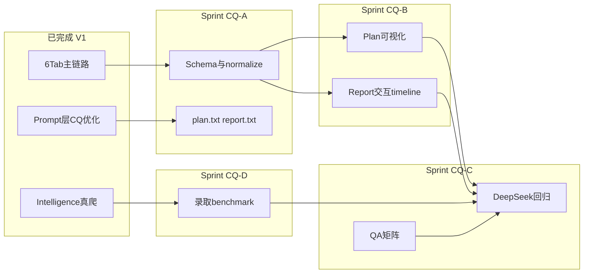

# V1 迭代路线图 V2 — 顾问方案与个性化报告内容产品化

**版本**：v2.0  
**更新日期**：2026-05-28  
**前置基线**：[V1-迭代路线图.md](V1-迭代路线图.md)（Sprint 1–7 已完成，M4 达成）  
**关联优化计划**：`.cursor/plans/香港留学_agent_-_顾问方案与个性化报告内容质量产品化优化路线_b2a0aefd.plan.md`（CQ Phase 1–4，**Prompt 层已落地，工程与 UI 层待续**）

---

## 一、当前项目进度标定（2026-05-28）

### 1.1 总体完成度

| 维度 | 进度 | 说明 |
|------|------|------|
| **6 Tab 主链路** | **95%** | Chat → Profile → Plan → Report → History → Intelligence 可跑通 |
| **Intelligence 真爬** | **90%** | 港八大×7 类、每日任务、审核、AI 引用白名单 |
| **V1 工程化 / 部署** | **90%** | Docker、备份、冒烟脚本就绪；公网 HTTPS 待运维 |
| **Plan/Report 内容质量（Prompt）** | **70%** | plan/report.txt + benchmark 引用指引 |
| **Plan/Report 内容质量（工程/UI）** | **95%** | CQ-A–D 全闭环；V2 迭代完成 |

### 1.2 项目结构速览

```
香港留学配置方案agent/
├── backend/
│   ├── src/
│   │   ├── modules/          # chat, profile, plan, report, history, intelligence 路由
│   │   ├── intelligence/     # 真爬、检索、intelContextPack、citation 白名单
│   │   ├── planning-service.js   # 方案生成（Prompt 已含 HK 规则）
│   │   ├── report-service.js     # 报告生成（Prompt + mock action_plan 已强化）
│   │   ├── citation-utils.js
│   │   └── agent.js / orchestrator.js
│   ├── prompts/v1/
│   │   ├── advisor.txt       # [x] 已加个性化故事指引
│   │   ├── collection.txt / confirmation.txt / style.txt / system.txt
│   │   └── （待建 plan.txt / report.txt）
│   ├── scripts/
│   │   ├── deepseek-regression-smoke.mjs  # 12 Mock 用例；真实 API 仅 1 条
│   │   └── intelligence:daily / sync-feeds
│   └── tests/                # test:v1-p6 73 pass / 1 skip
├── frontend/
│   └── src/pages/
│   │   ├── plan.js           # fit_note / urgency / 执行路径 / 引用增强
│   │   └── report.js         # 交互 30/60/90 checklist + 风险仪表盘
├── docs/
│   ├── schemas/plan-result.schema.json   # 含 fit_note / timeline_urgency / citations
│   ├── schemas/report-delivery.schema.json
│   └── v1.verson/            # V2 路线图 + CQ QA 矩阵
└── progress.md               # Sprint 1–7 + 情报真爬日志
```

### 1.3 CQ 优化计划已完成 vs 待续

| CQ Phase | 计划内容 | 实际状态 | 缺口 |
|----------|----------|----------|------|
| **CQ-1** Intelligence 深度集成 | intelContextPack + citation 校验 | [x] benchmark 种子 + 加权检索 | — |
| **CQ-2** 香港专家规则 | JUPAS/权重/rolling/奖学金 | [x] `plan.txt` / `report.txt` + mock `fit_note` | normalize 已透传；概率仍为 qualitative |
| **CQ-3** 可执行性打磨 | 30/60/90 checklist + 前端可视化 | [x] mock + CQ-B UI | 概率仍为 qualitative |
| **CQ-4** 质量评估与故事 | QA 矩阵 + 个性化 | [x] QA 矩阵 + `content-quality-score` + 16 mock 回归 | 人工抽检签字待试点 |

---

## 二、V2 迭代目标

在 V1 可试用基线上，将 **Plan（顾问方案）** 与 **Report（个性化专属报告）** 从「能跑通」升级为「内容质量可感知、可验证、可产品化」，与普通大模型聊天形成稳定差异：

1. **可验证**：关键断言绑定 Intelligence 条目，citation 覆盖率可量化  
2. **可执行**：30/60/90 天路径在前端可交互、可勾选、可提醒  
3. **可解释**：reach/match/safety 含程序权重匹配说明（`fit_note`）  
4. **可回归**：DeepSeek 真实场景 10+ 用例 + 自动化内容质量守门  

**建议周期**：4 周（Sprint CQ-A → CQ-D），可与云试点运维并行。

---

## 三、Sprint 拆解与详细任务清单

### Sprint CQ-A（Week 1）— 数据契约与后端补全

**目标**：Prompt 新增字段在 API 层可持久化、可测试、可被前端消费。

| ID | 任务 | 文件 / 参考 | 验收标准 | 估时 |
|----|------|-------------|----------|------|
| CQ-A-01 | `normalizePlanResult` 透传 `fit_note` | `backend/src/planning-service.js` | tier 对象含可选 `fit_note`；mock/真实生成均保留 | 2h |
| CQ-A-02 | 扩展 `plan-result.schema.json` | `docs/schemas/plan-result.schema.json` | 新增 `fit_note`、`risk_note`、`timeline_urgency`、`citations` 定义 | 1h |
| CQ-A-03 | 报告 delivery 块结构化字段契约 | 新建 `docs/schemas/report-delivery.schema.json` | 定义 `action_plan.{days_30,days_60,days_90}`、`parent_summary`、`risk_items[]` | 2h |
| CQ-A-04 | `buildMockStructuredPlan` 输出示例 `fit_note` | `planning-service.js` | Mock 方案三档均含 HK 权重示例句 | 1h |
| CQ-A-05 | 抽取 Plan Prompt 至独立文件 | 新建 `backend/prompts/v1/plan.txt`；`planning-service.js` 读取 | 与 inline system 等价；便于版本 diff | 2h |
| CQ-A-06 | 抽取 Report Prompt 至独立文件 | 新建 `backend/prompts/v1/report.txt`；`report-service.js` 读取 | 同上 | 2h |
| CQ-A-07 | 单元测试：新字段 normalize | 新建或扩展 `backend/tests/v1-cq-plan-report.test.js` | `fit_note` / `action_plan` 解析与 mock 覆盖 | 3h |
| CQ-A-08 | verify 脚本 | `backend/scripts/verify-v1-cq-a.mjs` | `npm run test:v1-cq-a` 绿 | 1h |

**Sprint CQ-A 勾选**

- [x] CQ-A-01 normalizePlanResult 透传 fit_note
- [x] CQ-A-02 plan-result.schema.json 扩展
- [x] CQ-A-03 report-delivery.schema.json
- [x] CQ-A-04 mock fit_note 示例
- [x] CQ-A-05 plan.txt 抽取
- [x] CQ-A-06 report.txt 抽取
- [x] CQ-A-07 单元测试
- [x] CQ-A-08 verify 脚本

**门禁**：`npm run test:v1-p6` 仍全绿 + `test:v1-cq-a` 通过。 ✅ 2026-05-28

---

### Sprint CQ-B（Week 2）— 前端可视化（最高优先级）

**目标**：用户打开 Plan/Report 即可感知「不是普通聊天」—— 有时间线、有风险、有 checklist。

| ID | 任务 | 文件 / 参考 | 验收标准 | 估时 |
|----|------|-------------|----------|------|
| CQ-B-01 | Plan 页渲染 `fit_note` | `frontend/src/pages/plan.js` | 每档 tier 卡片下方展示「程序匹配度」短句 | 2h |
| CQ-B-02 | Plan 页时间压力可视化 | `plan.js` + `frontend/src/copy.js` | `timeline_urgency` 映射为 relaxed/normal/tight 色条 + 文案 | 2h |
| CQ-B-03 | Plan 页「执行路径」摘要区 | `plan.js` | 从 `timeline_suggestion` + tiers 提炼 3–5 条 next actions 卡片 | 3h |
| CQ-B-04 | Report 页解析 `#action-plan` 为交互组件 | `frontend/src/pages/report.js` + 新建 `lib/action-plan-ui.js` | 30/60/90 分栏；每项可勾选（localStorage 持久化） | 6h |
| CQ-B-05 | Report 风险仪表盘 | `report.js` + `style.css` | 从 ch5 或 delivery 块提取高/中/低风险标签展示 | 4h |
| CQ-B-06 | 引用区增强 | `plan.js` / `report.js` | 展示 `quoteOrSummary` 摘要 + 情报 itemId 跳转 Intelligence Tab | 3h |
| CQ-B-07 | 375px 响应式 | `style.css` | timeline / 仪表盘无横向溢出 | 2h |
| CQ-B-08 | 前端单测 | `frontend/src/copy.test.js` 或新建 | urgency / action-plan 渲染 helper 覆盖 | 2h |

**Sprint CQ-B 勾选**

- [x] CQ-B-01 Plan fit_note 渲染
- [x] CQ-B-02 timeline_urgency 可视化
- [x] CQ-B-03 Plan 执行路径摘要
- [x] CQ-B-04 Report 交互式 30/60/90
- [x] CQ-B-05 Report 风险仪表盘
- [x] CQ-B-06 引用区增强
- [x] CQ-B-07 移动端适配
- [x] CQ-B-08 前端单测

**门禁**：手测 [V1-主链路QA用例.md](V1-主链路QA用例.md) Plan/Report 两 Tab；`frontend npm test && npm run build` 通过。 ✅ 2026-05-28

---

### Sprint CQ-C（Week 3）— 真实模型回归与内容 QA

**目标**：DeepSeek 场景下内容质量可重复、可打分、可归档。

| ID | 任务 | 文件 / 参考 | 验收标准 | 估时 |
|----|------|-------------|----------|------|
| CQ-C-01 | 扩展 DeepSeek 回归至 10+ 用例 | `backend/scripts/deepseek-regression-smoke.mjs` | 含建档 3 + 方案 3 + 报告 3 + 引用校验 2 | 4h |
| CQ-C-02 | 内容 QA 评分脚本 | 新建 `backend/scripts/content-quality-score.mjs` | 对 plan/report 输出打分：citation 数、fit_note 存在、action_plan 条数、禁词（录取承诺） | 4h |
| CQ-C-03 | QA 矩阵文档 | 新建 `docs/v1.verson/V1-CQ-内容质量QA矩阵.md` | 四维度：真实性 / 可执行性 / 香港深度 / 故事成长；每项 1–5 分 rubric | 2h |
| CQ-C-04 | 人工抽检模板 | 扩展 `V1-Sprint6-QA-归档-2026-05-28.md` 或新建 CQ 归档 | Plan/Report 各 5 条 checklist + 签字栏 | 1h |
| CQ-C-05 | CI 可选 job | README + package.json script | `npm run test:v1-cq-regression`（无 API Key 时 skip live） | 2h |
| CQ-C-06 | Prompt 温度 / 示例调优 | `plan.txt` / `report.txt` | 基于 CQ-C-01 结果迭代 1 轮；记录于 findings | 4h |

**Sprint CQ-C 勾选**

- [x] CQ-C-01 DeepSeek 10+ 回归
- [x] CQ-C-02 content-quality-score 脚本
- [x] CQ-C-03 QA 矩阵文档
- [x] CQ-C-04 人工抽检模板
- [x] CQ-C-05 npm script + skip 逻辑
- [x] CQ-C-06 Prompt 调优记录

**门禁**：Mock 路径 16 用例绿；`content-quality-score` combined PASS；`test:v1-cq-regression` 全绿。配置 `DEEPSEEK_API_KEY` 后 10 live 用例 ≥80% 通过 QA 阈值。 ✅ 2026-05-28（Mock 路径）

---

### Sprint CQ-D（Week 4）— Intelligence 基准数据 enrichment

**目标**：方案/报告的「数据驱动」有真实 benchmark 可引用，而非仅政策/截止日期。

| ID | 任务 | 文件 / 参考 | 验收标准 | 估时 |
|----|------|-------------|----------|------|
| CQ-D-01 | 录取 benchmark 种子数据 | 新建 `backend/data/intelligence/admission-benchmarks.json` | 港八大热门项目 ≥20 条：GPA/语言/科目权重/竞争度标签 | 4h |
| CQ-D-02 | intelContextPack 检索加权 | `intelContextPack.js` | plan/report 生成时 benchmark 类条目优先 Top-N | 3h |
| CQ-D-03 | structured-extract 扩展 | `structured-extract.js` | 支持 `benchmarkGpa`、`subjectWeights[]` 字段（可选） | 4h |
| CQ-D-04 | Plan mock 引用 benchmark | `buildMockStructuredPlan` | citations 优先绑定 benchmark 条目 | 2h |
| CQ-D-05 | Intelligence 卡片展示 benchmark | `frontend/src/pages/intelligence.js` | 结构化字段可见「参考基准」 | 2h |
| CQ-D-06 | 文档更新 | `V1-Intelligence技术附录.md` | 新增 benchmark 数据模型与维护说明 | 1h |

**Sprint CQ-D 勾选**

- [x] CQ-D-01 admission-benchmarks.json
- [x] CQ-D-02 context pack 加权
- [x] CQ-D-03 structured-extract 扩展
- [x] CQ-D-04 mock 引用 benchmark
- [x] CQ-D-05 Intelligence UI
- [x] CQ-D-06 技术附录

**门禁**：生成方案 citations ≥1 且含 benchmark；Intel 搜索「GPA 基准」可命中种子；`npm run test:v1-cq-d` 全绿。 ✅ 2026-05-28

---

## 四、依赖关系



---

## 五、里程碑与验收

| 里程碑 | 周次 | 关键交付 | 状态 |
|--------|------|----------|------|
| **M-CQ1** | Week 1 | Schema + normalize + 独立 Prompt 文件 | [x] 2026-05-28 |
| **M-CQ2** | Week 2 | Plan/Report 前端可视化上线 | [x] 2026-05-28 |
| **M-CQ3** | Week 3 | 10+ DeepSeek 回归 + QA 矩阵 | [x] 2026-05-28 |
| **M-CQ4** | Week 4 | Benchmark 数据 + Intel 加权 | [x] 2026-05-28 |

**整体验收标准（V2 完成）**

- [x] 用户侧：Plan 页可见 fit_note + 时间压力；Report 页 30/60/90 可勾选  
- [x] 数据侧：方案/报告 citation 白名单校验通过；benchmark 种子可检索  
- [ ] 质量侧：QA 矩阵四维度人工抽检 ≥4/5；DeepSeek live 回归 ≥80% 达标（Mock 路径已绿）
- [x] 工程侧：`test:v1-p6` + `test:v1-cq-a` + `test:v1-cq-regression` + `test:v1-cq-d` + frontend build 全绿  

---

## 六、不在 V2 范围（延续 V1 冻结）

- 站内提醒 / 关注徽标（见 [V1-本期范围冻结说明.md](V1-本期范围冻结说明.md)）  
- 多方案对比、支付、完整院校 DB  
- Postgres 迁移（试点期仍用 JSON + 备份）  
- 精确录取概率百分比（仅 qualitative reach/match/safety + benchmark 参考）  

---

## 七、推荐执行顺序（给研发排期）

1. **本周优先 CQ-A + CQ-B 并行前半**：Schema/normalize 是前端 UI 的前置依赖  
2. **Week 2 全力 CQ-B**：对齐产品痛点「可执行性可视化」  
3. **Week 3 CQ-C**：有 UI 后再做真实模型回归，避免空测 Prompt  
4. **Week 4 CQ-D**：benchmark 数据可增量交付，不阻塞 CQ-B 上线  

---

## 八、变更记录

| 日期 | 说明 |
|------|------|
| 2026-05-28 | CQ-D 完成：24 条 admission-benchmarks、intelContextPack 加权、Intelligence UI 参考基准、`test:v1-cq-d` 9 pass |
| 2026-05-28 | CQ-C 完成：16 mock 回归 + content-quality-score + QA 矩阵/归档；`test:v1-cq-regression` 7 单测 + verify 绿 |
| 2026-05-28 | CQ-B 完成：Plan fit_note/urgency/exec path；Report 交互 action-plan + 风险仪表盘 + 引用增强；30 FE tests + build |
| 2026-05-28 | CQ-A 完成：fit_note normalize、schema、plan.txt/report.txt、8 测试 + verify-v1-cq-a；test:v1-p6 73 pass |
| 2026-05-28 | 初版：基于 CQ 优化后续建议 + 项目结构审计 + 进度标定 |
