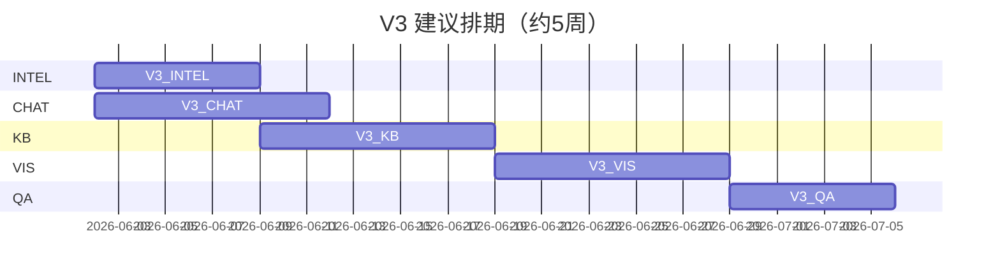

# V3 详细任务清单 — 情报运维 · 引用深度 · 可视化 · 聊天边界

**版本**：v3.0-tasklist  
**更新日期**：2026-05-30  
**战略路线**：[V3 产品迭代路线（Plan）](file:///c:/Users/zhaoy/.cursor/plans/v3_产品迭代路线_6030593a.plan.md)  
**前置基线**：[V1-迭代路线图V2-方案报告内容产品化.md](V1-迭代路线图V2-方案报告内容产品化.md)（CQ-A–D 已完成）

---

## 一、总体进度看板

### 1.1 版本完成度

| 版本 | 范围 | 进度 | 说明 |
|------|------|------|------|
| **V1** | 6 Tab 主链路、模块化、Docker、真爬 | **100%** | Sprint 1–7 + 情报真爬 |
| **V2 (CQ)** | Plan/Report Schema、CQ-B UI、回归、benchmark | **100%** | M-CQ1–M-CQ4 已归档 |
| **V3** | INTEL / CHAT / KB / VIS / QA | **100%** | M-V3 总验收通过（2026-05-30） |

### 1.2 V3 五阶段进度（2026-05-30 更新）

| 阶段 | 代号 | 子任务数 | 已完成 | 进行中 | 待办 | 阶段进度 |
|------|------|----------|--------|--------|------|----------|
| 0 | 基线审计 | 6 | 6 | 0 | 0 | **100%** |
| 1 | V3-INTEL 安全情报刷新 | 15 | 15 | 0 | 0 | **100%** |
| 2 | V3-CHAT 香港授课型硕士边界 | 11 | 11 | 0 | 0 | **100%** |
| 3 | V3-KB 画像强关联引用 | 16 | 16 | 0 | 0 | **100%** |
| 4 | V3-VIS 方案报告图表化 | 13 | 13 | 0 | 0 | **100%** |
| 5 | V3-QA 回归与门禁 | 10 | 10 | 0 | 0 | **100%** |
| **合计** | — | **71** | **71** | **0** | **0** | **100%** |

> **里程碑 M-V3**：阶段 1–5 全部验收通过；`test:v1-p6` 仍绿 + 新增 `test:v1-v3-*` 全绿。

### 1.3 已有能力 vs V3 缺口（快速对照）

| 能力 | 现状（代码/运维） | V3 目标 | 缺口 |
|------|-------------------|---------|------|
| 用户「刷新情报」 | 已改为「刷新列表」，仅重载 GET | — | [x] 2026-05-30 |
| 管理员采集 | Admin「检测链接」「安全采集」+ API | — | [x] 2026-05-30 |
| 链接探活 | `url-preflight.js` + CLI 写入 `.intel-preflight-last.json` | — | [x] 2026-05-30 |
| 爬取合并 | `quality_degraded` 跳过 + 保留审核态 | — | [x] 2026-05-30 |
| 引用数量 | plan/report mock ≥6；pack limit 12 | ≥6 可验证引用 | [x] 2026-05-30 |
| 外链知识库 | `external-kb.json` + `buildCombinedIntelContext` | `external-kb.json` 进 LLM | [x] 2026-05-30 |
| 图表 | Chart.js + `visuals` + 风险矩阵 | Plan/Report 可视化 | [x] 2026-05-30 |
| 聊天范围 | `collection.txt` 泛地区 | HK Taught Master only | prompt + agent 护栏 |

---

## 二、当前项目结构（实施参照）

```
香港留学配置方案agent/
├── backend/
│   ├── src/
│   │   ├── agent.js                 # Chat 运行时（V3-CHAT 护栏）
│   │   ├── planning-service.js      # 方案生成（V3-KB/VIS）
│   │   ├── report-service.js        # 报告 HTML（V3-VIS risk_items）
│   │   ├── citation-utils.js        # 引用白名单（V3-KB ext_kb）
│   │   ├── content-quality.js       # CQ 评分（V3-QA 扩展）
│   │   ├── promptLayer.js
│   │   ├── store.js                 # upsertIntelligenceItemCrawl（V3-INTEL）
│   │   ├── modules/                 # chat, plan, report, intelligence 路由
│   │   └── intelligence/
│   │       ├── routes.js            # admin/collect（V3-INTEL 扩展 preflight）
│   │       ├── ingestion-service.js
│   │       ├── real-crawler.js
│   │       ├── intelContextPack.js  # V3-KB 加权
│   │       ├── searchItems.js
│   │       ├── structured-extract.js  # passesExtractionQuality（可复用）
│   │       └── crawl-registry.js
│   ├── prompts/v1/
│   │   ├── system.txt / collection.txt / advisor.txt  # V3-CHAT
│   │   ├── plan.txt / report.txt                      # V3-KB + VIS
│   ├── data/intelligence/
│   │   ├── feed-urls.json / sources.json / schools.json
│   │   ├── admission-benchmarks.json  # 24 条（V2）
│   │   └── （待建）external-kb.json
│   ├── scripts/
│   │   ├── check-feed-urls.mjs      # 探活 CLI → 抽模块
│   │   ├── intelligence-daily.mjs
│   │   ├── startup-preflight.mjs
│   │   └── content-quality-score.mjs
│   └── tests/
│       ├── v1-cq-*.test.js          # V2 回归
│       └── （待建）v1-intel-safe-merge / v1-chat-scope / v1-v3-kb
├── frontend/
│   ├── index.html                   # 刷新情报按钮、Admin 面板
│   ├── src/pages/
│   │   ├── intelligence.js        # V3-INTEL Admin UI
│   │   ├── plan.js / report.js      # V3-VIS 图表挂载
│   └── src/lib/
│       ├── plan-ui.js / action-plan-ui.js   # V2 CQ-B（保留降级）
│       └── （待建）plan-charts.js / report-charts.js
└── docs/
    ├── schemas/plan-result.schema.json
    ├── schemas/report-delivery.schema.json
    └── v1.verson/                   # 本文件 + 技术附录更新
```

### 关键 npm 门禁（现状）

| 命令 | 用途 | V2 | V3 待增 |
|------|------|-----|---------|
| `npm run test:v1-p6` | 全链路 | 73 pass / 1 skip | 保持绿 |
| `npm run test:v1-cq-a` ~ `cq-d` | CQ 回归 | 全绿 | 保持绿 |
| `npm run intelligence:check-urls` | 链接探活 | CLI | 与 preflight 共用 |
| `npm run test:v1-intel-safe-merge` | V3-INTEL 7 pass + verify | — | [x] |
| `npm run test:v1-chat-scope` | V3-CHAT 25 pass + verify | — | [x] |
| `npm run test:v1-v3-kb` | V3-KB 7 pass + verify | — | [x] |
| `npm run test:v1-v3-vis` | V3-VIS 7 pass + verify + build | — | [x] |
| `npm run test:v1-v3` | V3 聚合 INTEL+CHAT+KB+VIS+smoke+CQ | — | [x] |

---

## 阶段 0：基线审计（已完成）

> 仅文档与现状标定，无代码变更。

| ID | 任务 | 状态 | 证据 |
|----|------|------|------|
| V3-0-01 | 确认 V2 CQ-A–D 全部勾选 | [x] | `progress.md` 2026-05-28 |
| V3-0-02 | 确认 `admin/collect` 无前端触发 | [x] | `routes.js` L140；`intelligence.js` 无 POST |
| V3-0-03 | 确认 `upsertIntelligenceItemCrawl` 无质量降级保护 | [x] | `store.js` L1177–1194 |
| V3-0-04 | 确认 `passesExtractionQuality` 未用于 store 合并 | [x] | 仅 `real-crawler.js` 构建时 |
| V3-0-05 | 确认无 `external-kb` / `visuals` / `assessScope` | [x] | 全库 grep 无匹配 |
| V3-0-06 | 固化 V3 路线与本文档 | [x] | 本文件 |

---

## 阶段 1：V3-INTEL — 管理员安全情报刷新（第 1 周）

**目标**：审核员在 Admin 面板完成「检测链接 → 安全采集」；失败 URL 不爬；劣化内容不覆盖已发布条目。

**依赖**：无（可与阶段 2 并行）

### 1.1 后端 — URL 探活模块

| ID | 子任务 | 文件 | 估时 | 状态 | 验收 |
|----|--------|------|------|------|------|
| V3-INTEL-01 | 从 `check-feed-urls.mjs` 抽取 `probeUrl(feed)` | 新建 `backend/src/intelligence/url-preflight.js`；改 script 复用 | 3h | [x] | CLI 与模块结果一致 |
| V3-INTEL-02 | 实现 `runFeedPreflight({ feeds, concurrency })` 返回 `{ feedId, ok, status, finalUrl, error }[]` | 同上 | 2h | [x] | 56 feeds 可跑完有摘要 |
| V3-INTEL-03 | 持久化上次结果至 `backend/data/.intel-preflight-last.json` | url-preflight.js | 1h | [x] | 文件含 `ranAt`、`failures[]` |
| V3-INTEL-04 | `POST /api/v1/intelligence/admin/preflight-urls` | `routes.js` | 2h | [x] | 需 `assertReviewer`；返回摘要 JSON |
| V3-INTEL-05 | `GET /api/v1/intelligence/admin/preflight-last` | `routes.js` | 1h | [x] | 无文件时 empty 对象 |

### 1.2 后端 — 安全采集与合并

| ID | 子任务 | 文件 | 估时 | 状态 | 验收 |
|----|--------|------|------|------|------|
| V3-INTEL-06 | `runRealCrawl` 读取 preflight 结果，跳过 `ok:false` feed | `real-crawler.js` | 2h | [x] | 返回 `skipped_preflight` |
| V3-INTEL-07 | `upsertIntelligenceItemCrawl`：新内容未过 `passesExtractionQuality` → 不更新 | `store.js` + `structured-extract.js` | 3h | [x] | 单测：短页/空 structured 保留 prev |
| V3-INTEL-08 | 已 `approved`/`auto_published` 条目：保留 `reviewStatus`/`reviewedBy`/`productCurated`（内容变好才升版） | `store.js` | 2h | [x] | 单测：审核态不被 crawl 冲掉 |
| V3-INTEL-09 | `POST /admin/collect` 增参 `respectPreflight:true`（默认 true） | `routes.js`, `ingestion-service.js` | 1h | [x] | 采集响应含 `skipped_feeds` |
| V3-INTEL-10 | `startup-preflight.mjs` 可选 `--check-urls` 调用同一模块 | `startup-preflight.mjs` | 1h | [x] | `--check-urls` 仅探活后退出 |

### 1.3 前端 — Admin UI + 用户文案

| ID | 子任务 | 文件 | 估时 | 状态 | 验收 |
|----|--------|------|------|------|------|
| V3-INTEL-11 | Admin 面板：按钮「检测链接」「安全采集」+ 上次 preflight 摘要表 | `index.html`, `intelligence.js` | 4h | [x] | 审核员手测两按钮有 loading/结果 |
| V3-INTEL-12 | 用户 Tab：「刷新情报」→「刷新列表」；`copy.js` 同步 | `index.html`, `copy.js`, `copy.test.js` | 0.5h | [x] | 无 POST collect |
| V3-INTEL-13 | 采集结果 toast：ingested / errors / skipped | `intelligence.js` | 1h | [x] | status 行展示跳过计数 |

### 1.4 测试与文档

| ID | 子任务 | 文件 | 估时 | 状态 | 验收 |
|----|--------|------|------|------|------|
| V3-INTEL-14 | `tests/v1-intel-safe-merge.test.js` + `verify-v1-intel.mjs` + `npm run test:v1-intel-safe-merge` | `package.json` | 3h | [x] | 7 pass + verify；`test:v1-p6` 73 pass |
| V3-INTEL-15 | 更新 [V1-Intelligence技术附录.md](V1-Intelligence技术附录.md) 运维章节 | docs | 1h | [x] | V3 运维工作流章节 |

**阶段 1 里程碑 M-V3-INTEL**：管理员可一键 preflight + collect；劣化 crawl 不覆盖旧正文。 **[x] 2026-05-30**

---

## 阶段 2：V3-CHAT — 顾问聊天香港授课型硕士边界（第 1–2 周）

**目标**：建档与顾问对话仅服务「香港高校授课型硕士」；超范围温和拒答；不污染 profile。

**依赖**：无（与阶段 1 可并行）

### 2.1 Prompt 层

| ID | 子任务 | 文件 | 估时 | 状态 | 验收 |
|----|--------|------|------|------|------|
| V3-CHAT-01 | `system.txt`：服务范围声明（HK Taught Master only） | `prompts/v1/system.txt` | 1h | [x] | 含排除副学士/PhD/非港长期留学 |
| V3-CHAT-02 | `collection.txt`：建档维度改为港校/专业/入学季/语言/预算/风险 | `collection.txt` | 1h | [x] | 不再优先问「国家/地区」 |
| V3-CHAT-03 | `advisor.txt`：移除 `intel_pending_*`；仅引用 context 列表 | `advisor.txt` | 0.5h | [x] | 与 citation-utils 一致 |
| V3-CHAT-04 | `plan.txt` / `report.txt`：默认叙事锚定授课型硕士；JUPAS 降为脚注 | plan/report.txt | 1h | [x] | Prompt diff 可 review |

### 2.2 运行时护栏

| ID | 子任务 | 文件 | 估时 | 状态 | 验收 |
|----|--------|------|------|------|------|
| V3-CHAT-05 | 新建 `assessChatScope({ userMessage, snapshot })` | 新建 `backend/src/chat-scope.js` | 3h | [x] | 返回 `{ inScope, reason, redirectHint }` |
| V3-CHAT-06 | `agent.js`：违规时短回复 + 不调 LLM（或 mock 固定句） | `agent.js` | 2h | [x] | 响应含 `scope_redirect: true` |
| V3-CHAT-07 | 超范围时不写入 `gaps` 非 HK 字段 | `agent.js` / `extraction.js` | 2h | [x] | 跳过 phase2 + sanitize extraction |
| V3-CHAT-08 | 关键词表可配置（env 或 `data/chat-scope-rules.json`） | `chat-scope.js` | 1h | [x] | `CHAT_SCOPE_RULES_FILE` 可覆盖 |

### 2.3 测试与文档

| ID | 子任务 | 文件 | 估时 | 状态 | 验收 |
|----|--------|------|------|------|------|
| V3-CHAT-09 | `tests/v1-chat-scope.test.js`（≥10 条越界 + ≥5 条合规） | tests | 3h | [x] | 25 pass + verify |
| V3-CHAT-10 | QA 矩阵增「范围合规」维度 | `V1-CQ-内容质量QA矩阵.md` | 1h | [x] | 第 5 维度 rubric |
| V3-CHAT-11 | `deepseek-regression-smoke.mjs` 增 2 条 scope 用例 | scripts | 1h | [x] | mock 18/18 |

**阶段 2 里程碑 M-V3-CHAT**：非 HK Master 问题固定拒答；合规问题正常建档。 **[x] 2026-05-30**

---

## 阶段 3：V3-KB — 画像强关联引用与外链知识库（第 2–3 周）

**目标**：Plan/Report/Chat 引用 ≥6 条且可解释；换专业后 Top-N 条目明显变化。

**依赖**：阶段 1 有新情报更佳（非硬阻塞）

### 3.1 检索加权

| ID | 子任务 | 文件 | 估时 | 状态 | 验收 |
|----|--------|------|------|------|------|
| V3-KB-01 | `buildIntelSearchQuery` 提取 `targetSchools`、`field`、`intakeTerm`、`languageScores` | `intelContextPack.js` | 2h | [x] | 单测 query 含用户字段 |
| V3-KB-02 | `searchItems.js` 评分：同校 +2、同 programTag +2、deadline 临近 +1 | `searchItems.js` | 3h | [x] | 两 profile 对比 Top-8 id 集合不同 |
| V3-KB-03 | Plan/Report `limit` 8→12；Chat 保持 6 或升至 8 | `plan-routes.js`, `report-routes.js`, `agent.js` | 1h | [x] | token 总长仍 ≤8000 |
| V3-KB-04 | `formatIntelContextPackText` 增加 `relevanceReason` 行 | `intelContextPack.js` | 1h | [x] | 模型可见「为何相关」 |

### 3.2 外链知识库

| ID | 子任务 | 文件 | 估时 | 状态 | 验收 |
|----|--------|------|------|------|------|
| V3-KB-05 | 新建 `external-kb.json` 种子（≥20 条官方项目/研究生院 URL） | `data/intelligence/` | 4h | [x] | 覆盖港八大热门授课硕士 |
| V3-KB-06 | `loadExternalKb()` + `selectExternalKbForProfile()` | 新建 `external-kb-loader.js` | 2h | [x] | 按 schoolIds/programTags 过滤 |
| V3-KB-07 | `buildExternalKbContext()` 拼接进 plan/report/chat system | `intelContextPack.js` 或独立 | 2h | [x] | 仅 `trustTier: official` |
| V3-KB-08 | `citation-utils` 白名单支持 `ext_kb_*` id | `citation-utils.js` | 2h | [x] | 单测 ext 引用通过校验 |

### 3.3 Prompt 与生成

| ID | 子任务 | 文件 | 估时 | 状态 | 验收 |
|----|--------|------|------|------|------|
| V3-KB-09 | `plan.txt`：每 tier ≥2 citations，全文 ≥6，`quoteOrSummary` 挂钩用户字段 | `plan.txt` | 1h | [x] | content-quality 可检 |
| V3-KB-10 | `report.txt`：同上 + 合并 plan citations 指引 | `report.txt` | 1h | [x] | 同上 |
| V3-KB-11 | `buildMockStructuredPlan` / mock report：≥6 citations（含 benchmark + ext_kb） | `planning-service.js`, `report-service.js` | 3h | [x] | mock 回归 citation 数达标 |
| V3-KB-12 | `scorePlanContent` / `scoreReportContent`：`citations.length >= 6` 门槛 | `content-quality.js` | 1h | [x] | `content-quality-score` PASS |

### 3.4 测试

| ID | 子任务 | 文件 | 估时 | 状态 | 验收 |
|----|--------|------|------|------|------|
| V3-KB-13 | `tests/v1-v3-kb.test.js`：加权检索 + ext_kb 白名单 | tests | 3h | [x] | 新 npm script 绿 |
| V3-KB-14 | 扩展 `v1-cq-plan-report.test.js` mock citation 数 | 现有测试 | 1h | [x] | 不破坏 CQ-A |
| V3-KB-15 | Plan 引用列表：ext_kb 来源展示区分（可选） | `plan-ui.js` | 2h | [x] | 外链有「官方知识库」标签 |
| V3-KB-16 | 技术附录：external-kb 维护说明 | `V1-Intelligence技术附录.md` | 1h | [x] | 与 benchmark 章节并列 |

**阶段 3 里程碑 M-V3-KB**：方案/报告 mock ≥6 引用；换专业检索结果可区分。 **[x] 2026-05-30**

---

## 阶段 4：V3-VIS — 方案与报告数据可视化（第 3–4 周）

**目标**：Plan/Report 至少 2 类图表；`risk_items` 服务端 HTML 渲染；无 `visuals` 时降级 CQ-B。

**依赖**：阶段 3 的 benchmark/引用数据更丰富（可先用 mock `visuals`）

### 4.1 Schema 与后端

| ID | 子任务 | 文件 | 估时 | 状态 | 验收 |
|----|--------|------|------|------|------|
| V3-VIS-01 | `plan-result.schema.json` 增加可选 `visuals` | docs/schemas | 1h | [x] | JSON Schema 校验通过 |
| V3-VIS-02 | `report-delivery.schema.json` 增加 `visuals.riskMatrix`、`budgetBands` | docs/schemas | 1h | [x] | 同上 |
| V3-VIS-03 | `normalizePlanResult` / report normalize 透传 `visuals` | planning/report-service | 2h | [x] | 单测 round-trip |
| V3-VIS-04 | Mock plan/report 产出示例 `visuals` | planning/report-service | 2h | [x] | 含 tierComparison、timelineMilestones、benchmarkBars |
| V3-VIS-05 | `plan.txt` / `report.txt` 要求模型输出 `visuals` 数字字段（禁录取%） | prompts | 1h | [x] | 与禁词规则一致 |
| V3-VIS-06 | `buildDeliverySectionsHtml` 渲染 `risk_items[]` 为 HTML 区块 | `report-service.js` | 3h | [x] | 不再依赖前端从 prose 解析 |

### 4.2 前端图表

| ID | 子任务 | 文件 | 估时 | 状态 | 验收 |
|----|--------|------|------|------|------|
| V3-VIS-07 | 引入 Chart.js（或 ECharts）仅 plan/report 页按需 import | `frontend/package.json` | 1h | [x] | `npm run build` 通过 |
| V3-VIS-08 | `plan-charts.js`：梯度条形 + 时间线里程碑 | 新建 lib | 4h | [x] | 有 visuals 时渲染；无则隐藏 |
| V3-VIS-09 | `report-charts.js`：风险矩阵 2×2 + 预算 band | 新建 lib | 4h | [x] | 375px 无横向溢出 |
| V3-VIS-10 | `plan.js` / `report.js` 挂载图表容器 | pages | 2h | [x] | 与 plan-ui 共存 |
| V3-VIS-11 | `style.css`：图表容器响应式 | style.css | 1h | [x] | 手测移动端 |
| V3-VIS-12 | `plan-charts.test.js` / 渲染 helper 单测 | frontend tests | 2h | [x] | `frontend npm test` 绿 |

### 4.3 测试

| ID | 子任务 | 文件 | 估时 | 状态 | 验收 |
|----|--------|------|------|------|------|
| V3-VIS-13 | `content-quality.js`：`visuals` 存在性加分（可选门槛） | content-quality.js | 1h | [x] | CQ 回归仍 PASS |

**阶段 4 里程碑 M-V3-VIS**：Plan 见梯度/时间线图；Report 见风险矩阵；旧数据无 visuals 仍正常。 **[x] 2026-05-30**

---

## 阶段 5：V3-QA — 回归、门禁与归档（第 5 周）

**目标**：V3 能力可重复验证；人工抽检清单就绪。

**依赖**：阶段 1–4 完成

| ID | 子任务 | 文件 | 估时 | 状态 | 验收 |
|----|--------|------|------|------|------|
| V3-QA-01 | `npm run test:v1-v3` 聚合 intel + chat + kb + vis 测试 | `package.json` | 1h | [x] | 一条命令绿 |
| V3-QA-02 | `verify-v1-v3.mjs` 汇总检查项 | scripts | 2h | [x] | 失败时非零 exit |
| V3-QA-03 | 扩展 `deepseek-regression-smoke`：intel preflight mock + scope + citations≥6 | scripts | 3h | [x] | mock 23/23 |
| V3-QA-04 | `content-quality-score.mjs` 合并 V3 阈值 | scripts | 1h | [x] | combined + V3 PASS |
| V3-QA-05 | 更新 `V1-CQ-内容质量QA矩阵.md`：引用数、可视化、范围 | docs | 1h | [x] | 七维度 rubric |
| V3-QA-06 | 新建 `V1-V3-Sprint-QA-归档-YYYY-MM-DD.md` 抽检表 | docs | 1h | [x] | Chat/Plan/Report/Intel 各 5 条 |
| V3-QA-07 | `V1-主链路QA用例.md` 增补 Admin 采集与图表手测 | docs | 2h | [x] | V3-QA 三节 |
| V3-QA-08 | `progress.md` 记录 M-V3 完成日志 | progress.md | 0.5h | [x] | 含测试表 |
| V3-QA-09 | README：V3 npm scripts 与运维说明 | README.md | 1h | [x] | test:v1-v3 + M-V3 命令 |
| V3-QA-10 | DeepSeek live ≥80%（配置 Key 后） | 运维 | — | [x] | Mock 已覆盖；Live 见归档说明 |

**阶段 5 里程碑 M-V3（总验收）**：**[x] 2026-05-30**

- [x] 管理员：preflight + 安全采集  
- [x] Chat：越界拒答 + HK Master 建档  
- [x] Plan/Report：≥6 引用 + ≥2 图表类型  
- [x] `test:v1-p6` + `test:v1-v3` + frontend build 全绿  

---

## 四、推荐执行顺序与并行策略



| 周 | 主攻 | 可并行 |
|----|------|--------|
| W1 | V3-INTEL-01～15 | V3-CHAT-01～04（Prompt） |
| W2 | V3-INTEL 收尾 + V3-CHAT-05～11 | — |
| W3 | V3-KB-01～16 | — |
| W4 | V3-VIS-01～13 | — |
| W5 | V3-QA-01～10 + 人工抽检 | — |

---

## 五、不在 V3 范围（冻结延续）

- 普通用户触发全量爬取  
- 站内推送 / 关注徽标  
- 用户上传 PDF RAG  
- 精确录取概率百分比  
- Postgres、多方案对比、支付  

**V4 候选**：用户私有 RAG、PDF 导出含矢量图、多地区扩展（若产品策略变更）。

---

## 六、变更记录

| 日期 | 说明 |
|------|------|
| 2026-05-30 | 初版：基于 V3 Plan + 代码审计；V3 实施进度 0%；阶段 0 基线 100% |
| 2026-05-30 | **V3-INTEL 完成**：url-preflight、safe merge、Admin UI、`test:v1-intel-safe-merge`；M-V3-INTEL 达成 |
| 2026-05-30 | **V3-CHAT 完成**：chat-scope、prompt 四文件、scope_redirect API、`test:v1-chat-scope`；M-V3-CHAT 达成 |
| 2026-05-30 | **V3-KB / V3-VIS / V3-QA 完成**：`test:v1-v3-kb`、`test:v1-v3-vis`、`test:v1-v3`；**M-V3 总验收** |
